<div align="center">

# Tableau Viz Extensions

**Fifteen viz extensions for Tableau, built on the Tableau Viz Extensions API.**<br>
Drop fields on the Marks card, style everything from a Format dialog, no code in the workbook.


%20extensions-e8762d)


[KPI Card](#kpi-card) · [KPI Card Multi](#kpi-card-multi) · [Waterfall](#waterfall) · [Line Chart](#line-chart) · [Bar Chart](#bar-chart) · [Matrix](#matrix) · [Data Lineage](#data-lineage)<br>
[Sankey](#sankey) · [Funnel](#funnel) · [Bullet & Gauge](#bullet--gauge) · [Cohort Grid](#cohort-grid) · [Treemap & Donut](#treemap--donut) · [Maturity Ladder](#maturity-ladder) · [Parameter Switcher](#parameter-switcher) · [Narrative Card](#narrative-card)

</div>

---

## Contents

- [The extensions](#the-extensions)
- [What every extension can do](#what-every-extension-can-do)
- [Extension details](#kpi-card)
- [Getting started in Tableau](#getting-started-in-tableau)
- [Repository layout](#repository-layout)
- [Local development](#local-development)
- [Deploying](#deploying)
- [Author](#author)

## The extensions

| | Extension | What it draws | Marks card tiles | Manifest |
|---|---|---|---|---|
| 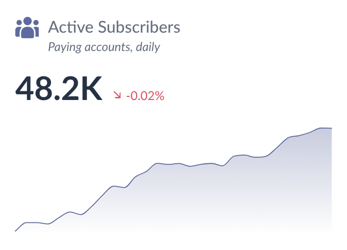 | [**KPI Card**](#kpi-card) | Latest value, % / pp change and a trend line | Measure · Date | [`kpiCard.trex`](kpi-card/kpiCard.trex) |
|  | [**KPI Card Multi**](#kpi-card-multi) | A row of KPI cards, one per measure, in one zone | Measures · Date | [`kpiCardMulti.trex`](kpi-card-multi/kpiCardMulti.trex) |
| 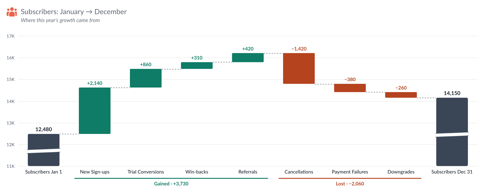 | [**Waterfall**](#waterfall) | Start → changes → End bridge chart | Start · Changes · End · Breakdown | [`waterfall.trex`](waterfall/waterfall.trex) |
|  | [**Line Chart**](#line-chart) | Lines and areas over a date, dual axis | Date · Measures · Color | [`line-chart.trex`](line-chart/line-chart.trex) |
| 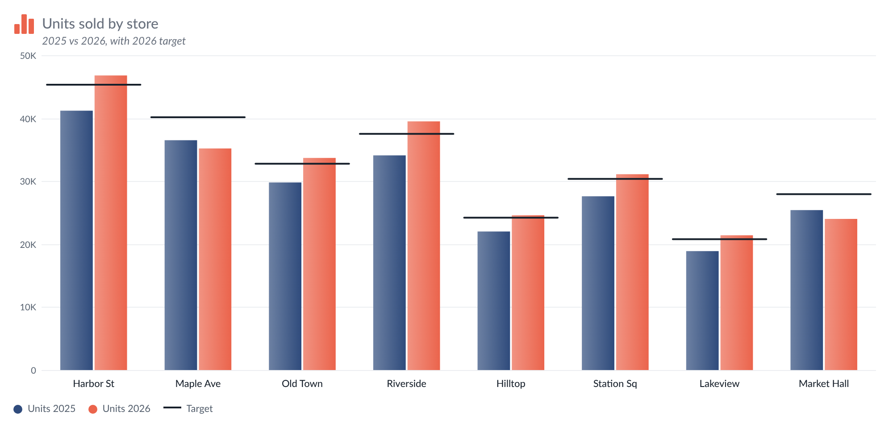 | [**Bar Chart**](#bar-chart) | Every common bar design, with drill-down | Dimension · Measure · Line · Target | [`bar-chart.trex`](bar-chart/bar-chart.trex) |
|  | [**Matrix**](#matrix) | Crosstab with heat map, totals and Excel export | Rows · Columns · Measure · Color | [`matrix-table.trex`](matrix-table/matrix-table.trex) |
|  | [**Data Lineage**](#data-lineage) | Sankey-style lineage flow with search | Levels · Details | [`data-lineage.trex`](data-lineage/data-lineage.trex) |
| 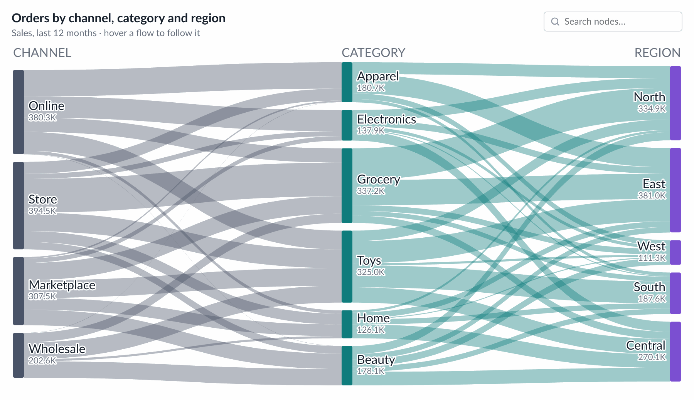 | [**Sankey**](#sankey) | Flow between levels, link thickness by a measure | Levels · Value | [`sankey.trex`](sankey/sankey.trex) |
| 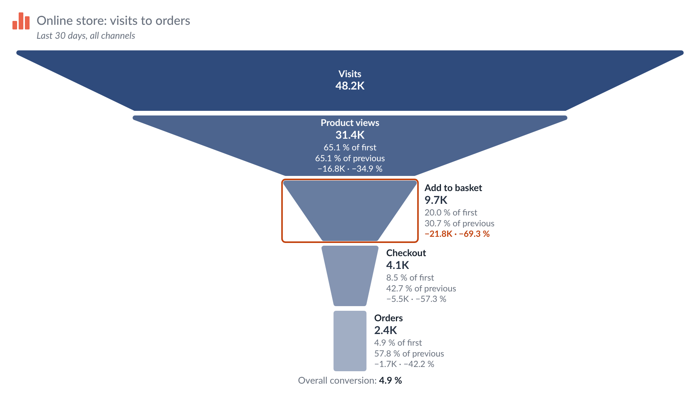 | [**Funnel**](#funnel) | Stages of a process with conversion and drop-off | Stages (measures) or Stage · Value | [`funnel.trex`](funnel/funnel.trex) |
| 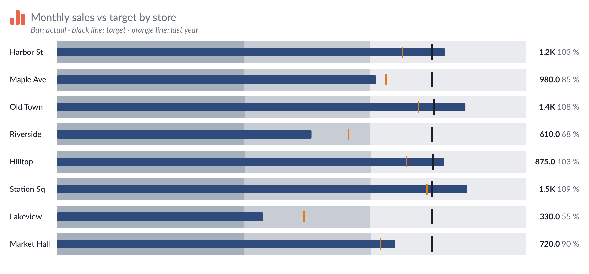 | [**Bullet & Gauge**](#bullet--gauge) | Actual against target with ranges, as bullets, gauges or progress bars | Category · Actual · Target · Ranges · Comparison | [`bullet-gauge.trex`](bullet-gauge/bullet-gauge.trex) |
| 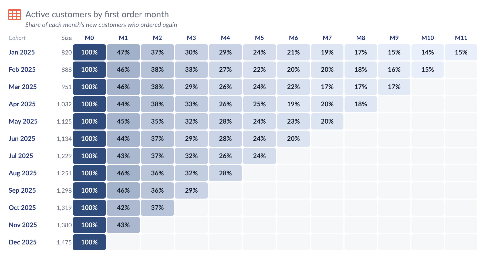 | [**Cohort Grid**](#cohort-grid) | Retention triangle: cohorts by periods since start, shaded by value | Cohort · Period · Value · Cohort size | [`cohort-grid.trex`](cohort-grid/cohort-grid.trex) |
| 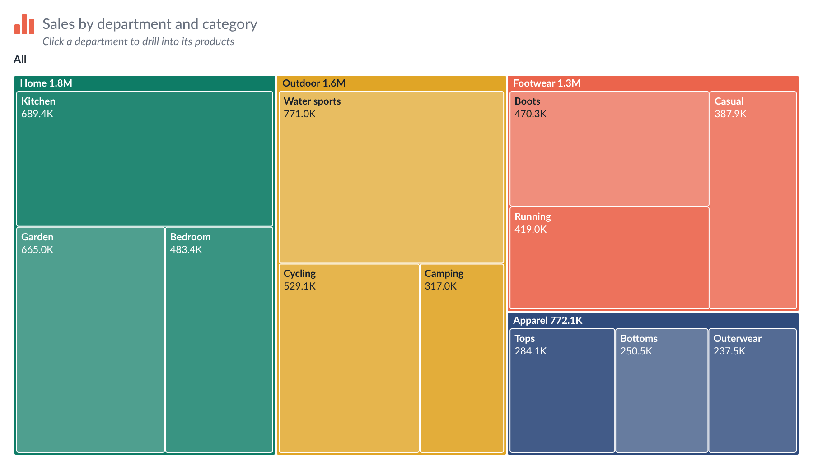 | [**Treemap & Donut**](#treemap--donut) | Composition of a whole as a treemap, donut or pie, with drill-down | Category · Size · Colour | [`treemap-donut.trex`](treemap-donut/treemap-donut.trex) |
| 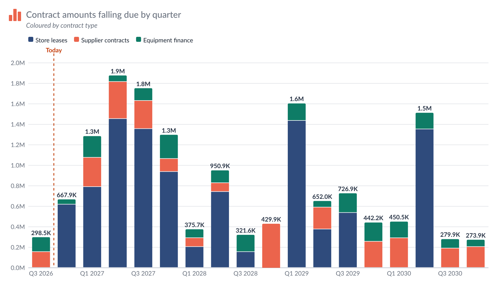 | [**Maturity Ladder**](#maturity-ladder) | Amounts falling due per time bucket, stacked by group, with a running total | Maturity date · Amount · Group · Item | [`maturity-ladder.trex`](maturity-ladder/maturity-ladder.trex) |
| 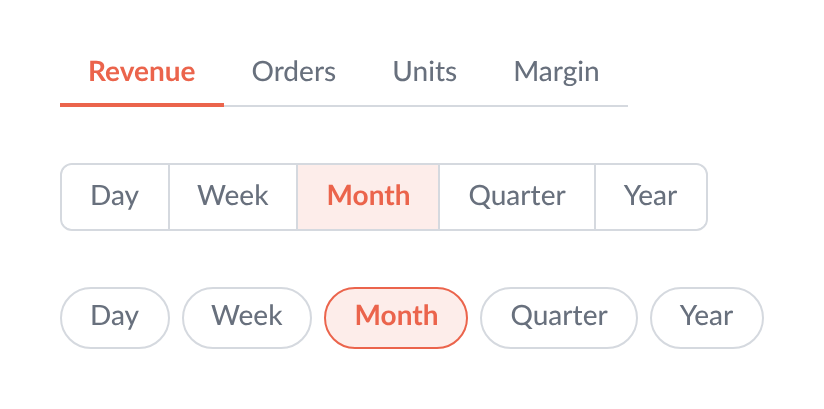 | [**Parameter Switcher**](#parameter-switcher) | Tabs, buttons, pills, a toggle or a stepper that set a Tableau parameter | Options (optional) | [`parameter-switcher.trex`](parameter-switcher/parameter-switcher.trex) |
| 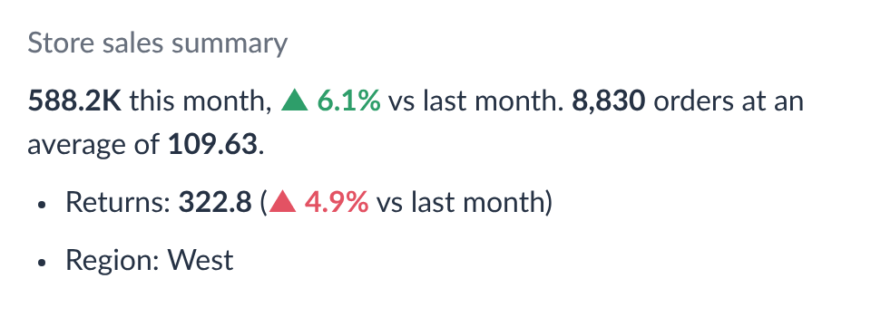 | [**Narrative Card**](#narrative-card) | Sentences you write, with live numbers, changes and conditions inside | Measures · Date | [`narrative-card.trex`](narrative-card/narrative-card.trex) |

## What every extension can do

- **Format dialog for everything.** Open it with **Format Extension** on the Marks card (or right-click the chart). The chart updates live behind it; **Cancel** undoes everything since it opened and **Reset tab** restores that tab's defaults. It stays on top of Tableau.
- **Card header** shared by all extensions: an icon (built-in icon set, Tableau shape palettes or your own upload), a title and an explanation line, each with full font control. Titles can show a parameter's value with `<Parameter name>`.
- **One number formatter** across the family: K / M / B / Dynamic / full / Percentage / workbook format, decimals, unit text, `+` sign, and negatives as `−201.4`, `-201.4` or `(201.4)`. Tooltips show full, unabbreviated values.
- **Settings live in the workbook.** They travel with it when you publish to Tableau Server, and new options always come with defaults so older workbooks keep working.
- **Works with dashboard actions.** A click selects marks in Tableau, so filter, highlight and go-to-sheet actions fire: a bar, node or cell (Bar Chart, Data Lineage, Matrix), a point or series (Line Chart), a breakdown segment (Waterfall), a card or a date on its trend line (KPI cards). It is a setting in each Format dialog; in Line Chart, Waterfall, Matrix and the KPI cards it is off until you switch it on.
- **Fast loading.** Tableau API calls are kept to a minimum (important when a dashboard has many extensions), shared files are downloaded once for all extensions, and a slow or rejected start-up is retried automatically, up to three times.
- **A row limit you control.** Each extension reads at most **1,000 rows** from the worksheet by default. *Format → Card → Maximum rows* changes it (0 = all rows). When rows are left out, a small note in the corner of the chart says so.
- **Nothing kept in the browser.** Chart data is never stored between visits; only your own Format-dialog presets are.
- **Presets everywhere.** Every Format dialog has a Presets tab: save a look and reuse it in another worksheet or workbook, as a file, via the clipboard or from *My presets*.
- **Brand themes.** The Presets tab of every extension can apply one theme file (colours, fonts, card style, number format), so a dashboard built from several extensions looks like one product. Two themes are bundled (Default, Midnight); you can save your own and they are offered in every extension.
- **Save as picture.** Every extension can save itself as a PNG: from the export menu where there is one, otherwise from a button that appears on hover (switch it on under *Format → Card → Export*).
- **Tableau's own tooltip, if you prefer it.** *Use Tableau's tooltip* (off by default) shows the tooltip you design in Tableau, including viz in tooltip, instead of the extension's.
- **Undo, redo and search in the Format dialog.** Ctrl/Cmd+Z works on every change, and the search box finds a setting on any tab.
- **Errors you can report.** If something goes wrong, a small **!** mark appears in the corner; click it for details (extension version, API version, the error) that you can copy to whoever supports the dashboard.
- **Self-contained.** No CDNs or external services: the Tableau Extensions API library and the Lato fonts are bundled.

---

## KPI Card

<p>
  
  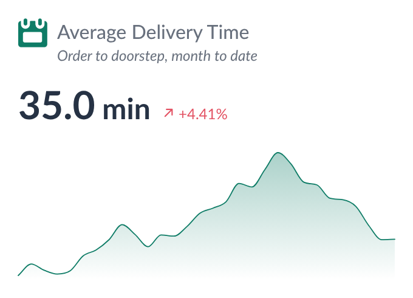
</p>

A single KPI: icon, title, explanation, **big number with unit**, **% or pp change** and a **trend line** (or "vs previous period" text).

**Tiles:** `Measure` (1) · `Date` (up to 4 levels, e.g. Year + Month + Day).

- Transparent background by default, so the card sits on any dashboard colour.
- Big number as a **single day** or **month to date** (sum for flows, average for balances and ratios).
- Compare with the **previous date** or the **same day last month** (month-end days clamp correctly), as **%** or **pp**.
- Arrows and colours follow *Increase is good*, so falling costs can show green.
- Trend line: smooth or straight, gradient fill, points shown, tooltips, height.
- 0–1 ratio support for percentage metrics (0.4523 → `45.23%`, 0.45 vs 0.40 → `+5.00 pp`).

[Full documentation →](kpi-card/README.md)


## KPI Card Multi

<p>
  
</p>
<p>
  
</p>

Up to **12 KPI cards in one extension zone**: each measure on the Measures tile becomes a card that looks and works like the single KPI Card.

**Tiles:** `Measures` (1–12) · `Date` (up to 4 levels).

- **One** permission check, handshake and data request for the whole row instead of one per card, which makes dashboards with many KPIs load much more reliably on Tableau Server.
- **Per-card or shared settings:** a card picker in the Format dialog; options tagged *this card* apply only to it, and **Apply to all** copies them to every card.
- Layout: minimum card width with wrapping rows, gap, and a width weight per card.
- Cards keep their settings when you change the aggregation (`SUM` → `AVG`).

[Full documentation →](kpi-card-multi/README.md)


## Waterfall

<p>
  
</p>
<p>
  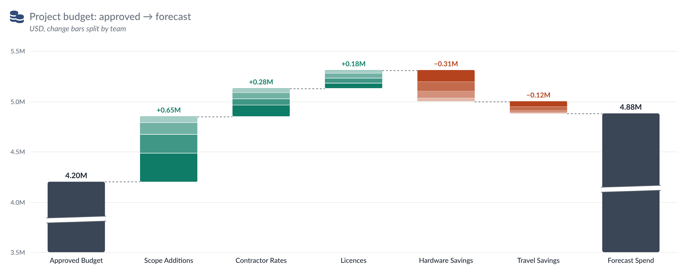
</p>

A bridge chart from a **Start** value through any number of **changes** to an **End** value.

**Tiles:** `Start` (1) · `Changes` (up to 30, one bar each, in tile order) · `End` (1, optional — calculated as Start + changes when empty) · `Breakdown` (up to 6 dimensions).

- Per-bar settings: label, colour (increase / decrease or custom), invert sign, total value placement.
- **Breakdown** dimensions split change bars into segments (top 10 shown).
- **Groups:** automatic runs of increases / decreases or custom named groups, with brackets and group totals.
- **Clipped-bar markers** when the axis doesn't start at zero.
- Connector lines, gridlines, zero line; one number format for all labels or each label its own.
- Right-click or double-click a bar to jump straight to its settings.

[Full documentation →](waterfall/README.md)

## Line Chart

<p>
  
</p>
<p>
  
</p>

Lines and areas for any number of measures over a date (or any dimension).

**Tiles:** `Date` (up to 4 levels) · `Measures` (up to 20) · `Color` (1 dimension, optional).

- Each series drawn as a **line, area or hidden**: colour, width, solid / dashed / dotted, straight / smooth / step.
- **Dual axis:** put any series on the left or right axis, each with its own range, title and number format.
- **Stacked** and **100% stacked** areas, gradient fills.
- **Dash the last N segments** to mark an incomplete period.
- **Reference lines:** constant target, average, median, min, max or latest value. **Band** between two measures and a forecast zone.
- Hover crosshair with every series, stacked totals and shares; interactive legend with latest values (click to hide, hover to highlight).

[Full documentation →](line-chart/README.md)

## Bar Chart

<p>
  
</p>
<p>
  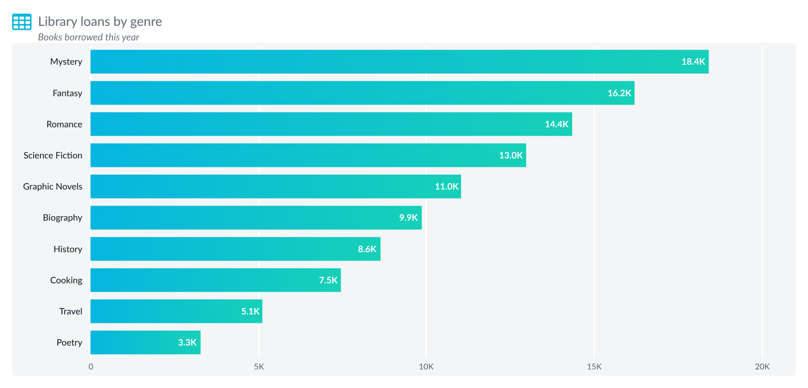
  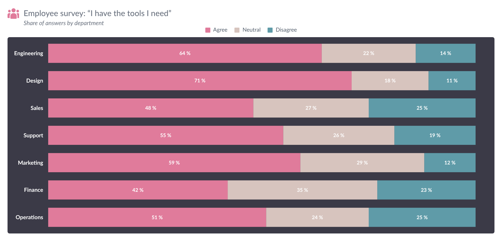
</p>
<p>
  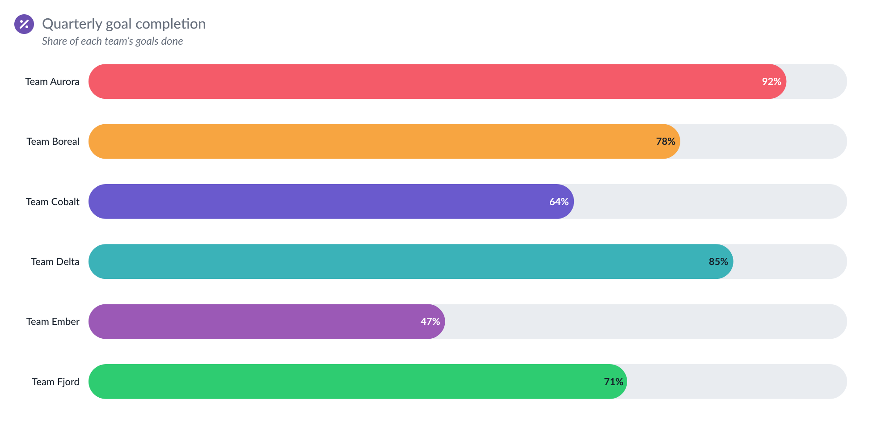
  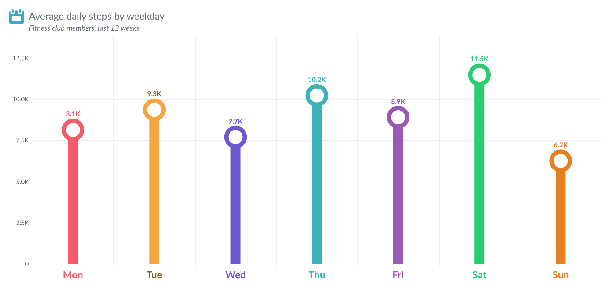
</p>

A bar chart for every common bar design, with 22 one-click **Quick looks**.

**Tiles:** `Dimension` (up to 6: bars, then breakdown and drill levels) · `Measure` (up to 12) · `Line` (up to 4 measures drawn over the bars) · `Target` (1). Measures on Tooltip add tooltip rows.

- **Layouts:** vertical or horizontal; grouped, stacked, 100% stacked, left-right comparison and overlapping.
- **Styles:** plain bars, **lollipops** or **filling (progress) bars**, rounded ends, gradients, two-tone fills.
- **Per-dimension roles:** bars, split bars, breakdown segments or **panels** (small multiples).
- **Drill-down** on double-click (expand one bar, show only its detail, or expand all) with Back / Reset.
- **Member icons** per bar, from the built-in set, Tableau shape palettes (bundled for GitHub Pages) or uploads.
- **Targets**, reference lines and bands; **Top N with Others**; sorting by any measure.
- **Comments:** right-click → *Add comment*, shown as a marker or callout and saved in the workbook.
- Rich tooltips (% of total, change vs previous bar, % of target), clickable legend, own right-click menu.
- **Data export** (Excel, CSV, copy) and **presets** (export, import, *My presets*).

[Full documentation →](bar-chart/README.md)

## Matrix

<p>
  
  
</p>

A crosstab with tile-style cells, built for reports that end up in Excel.

**Tiles:** `Rows` (up to 6 levels) · `Columns` (up to 6 levels) · `Measure` (up to 10) · `Color` (1 measure, optional). Measures on Tooltip add tooltip rows.

- One **main value** per cell with smaller, faded values under it: other measures, **% of total**, difference, % difference, running total, rank.
- **Heat-map** shading, − / + colours, data bars and colour rules.
- **Group totals that fold**, total rows and columns, banded rows, frozen headers, merged and rotated headers.
- **Diagonal mark** for From → To (transfer) matrices.
- **Export:** Excel *as shown* (colours, merged headers, number formats), Excel / CSV data, CSV crosstab, or **copy table** to paste into Excel or an email.
- Sort rows and columns, highlight row / column on hover, and **presets**.

[Full documentation →](matrix-table/README.md)

## Data Lineage

<p>
  
</p>
<p>
  
</p>

A lineage flow: every row is one path, such as *table → data source → workbook → view*.

**Tiles:** `Levels` (up to 6 dimensions, one column of nodes each) · `Details` (up to 8, as subtitles or tooltip lines).

- **Click a node** to highlight every path through it and select it in Tableau.
- **Search** across all columns: highlight or filter to the matching lineage.
- **Collapse / expand** nodes and whole levels; optionally start collapsed with only the first column.
- Node ordering for **fewest crossings**, most paths or name; curved, elbow or straight links.
- Tooltips with upstream / downstream counts per level; scrolls with sticky column headers when there are many nodes.
- **Presets** for the look.

[Full documentation →](data-lineage/README.md)

## Sankey

<p>
  
</p>
<p>
  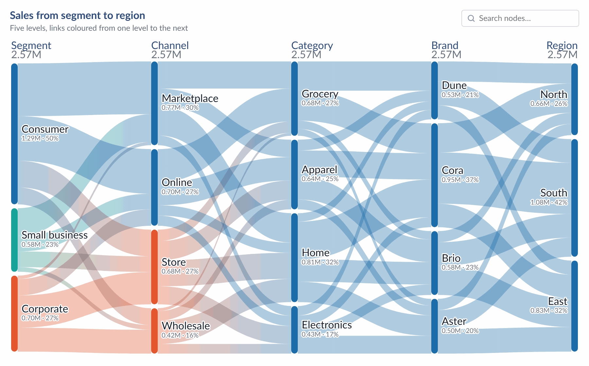
</p>

A flow diagram where **link thickness is a measure**: each dimension on Levels is a column of nodes, and a link is as thick as the summed Value of the rows that pass through both ends.

**Tiles:** `Levels` (2–6 dimensions, one column each, outermost first) · `Value` (1 measure) · Tableau's `Tooltip` (optional measures).

- **Hover** a node or link and everything flowing through it lights up; **click** to select it in Tableau.
- **Search** finds nodes by name in any column and highlights their flow (or shows only it).
- Labels with value and share of the column; labels that would overlap are left out.
- **Top N per level** with an "Others" node; rows with an empty level skip that column or show a "Null" node.
- Links coloured by source, target, a gradient or one colour; nodes by level, first-level member or one colour.
- **Presets** for the look.

[Full documentation →](sankey/README.md)

## Funnel

<p>
  
</p>
<p>
  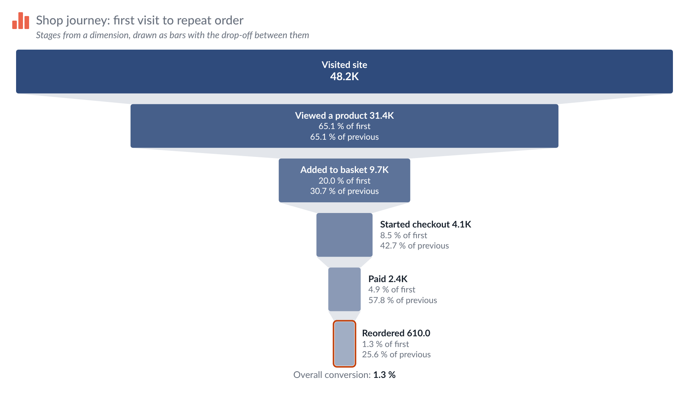
</p>

The stages of a process, each narrower than the one before, with the conversion and the drop-off between them.

**Tiles:** `Stages` (2–12 measures, one per stage) — or `Stage` (1 dimension) with `Value` (1 measure).

- Three shapes: **funnel** (trapezoids), **bars with drop-off** and **steps**.
- Labels: stage name, value, % of the first stage, % of the previous stage and the drop-off; they never overlap.
- Colours: one colour getting lighter, one per stage, or by conversion thresholds.
- The stage after the **biggest drop-off** is outlined; **overall conversion** under the chart.
- Click a stage to select it in Tableau (stages from a dimension); per-stage label, colour and hide.

[Full documentation →](funnel/README.md)

## Bullet & Gauge

<p>
  
</p>
<p>
  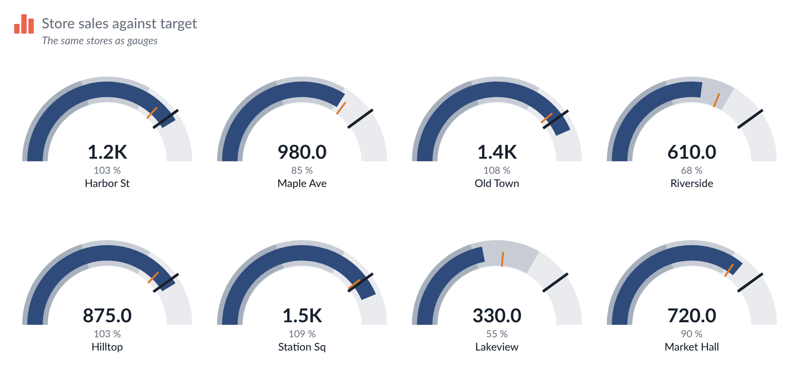
</p>

Actual against target, with qualitative ranges (poor / OK / good), drawn as **bullet rows**, **gauges** or **progress bars**.

**Tiles:** `Category` (0–2 dimensions, optional) · `Actual` (1 measure) · `Target` (1, optional) · `Ranges` (up to 3, optional) · `Comparison` (1, optional).

- Bands from your Ranges measures, or at percentages of the target when there are none.
- Target tick, comparison tick (e.g. last year) and the value with its **% of target**.
- **Status colours**: the actual bar turns red / amber / green by % of target.
- **Lower is better** reverses band and status colours (costs, errors, wait times).
- Sort, **Top N**, one shared scale or each row its own.

[Full documentation →](bullet-gauge/README.md)

## Cohort Grid

<p>
  
</p>
<p>
  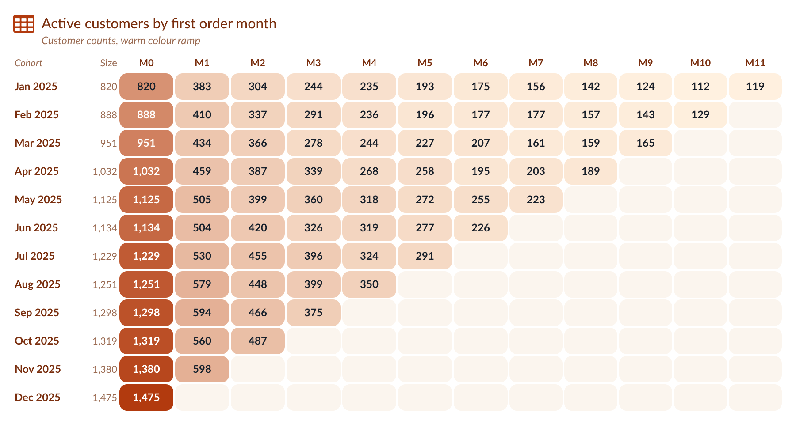
</p>

A retention (cohort) triangle: one row per cohort, one column per period since the cohort started, every cell shaded by its value.

**Tiles:** `Cohort` (1 dimension) · `Period` (1 dimension: a number or a date) · `Value` (1 measure) · `Cohort size` (1 measure, optional).

- Cells show **% of cohort size** (retention), the value, or % of the previous period.
- **Heat map**: light-to-dark ramp, automatic or fixed limits, one scale for the grid or each cohort.
- Optional **Average** row, frozen headers, period headers from a template (`M{n}`, `Month {n}`).
- Sort cohorts, last N cohorts, first N periods; click a cell to select its cohort and period in Tableau.
- **Export** to Excel and CSV (grid as shown or the data), copy, and save as picture.

[Full documentation →](cohort-grid/README.md)

## Treemap & Donut

<p>
  
</p>
<p>
  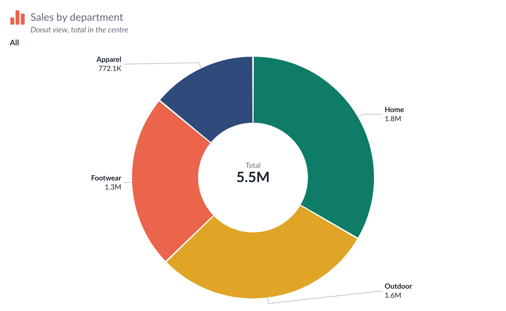
</p>

The composition of a whole, with drill-down through a hierarchy: a **treemap**, a **donut** or a **pie**.

**Tiles:** `Category` (1–4 dimensions, outermost first) · `Size` (1 measure) · `Colour` (1 measure, optional).

- **Drill**: click a tile or slice to look inside it; the path above the chart ("All › Apparel › Shoes") goes back.
- Treemap with one or two levels shown at once; donut with the total (or the hovered slice) in the centre.
- Small slices grouped into "Others"; donut labels with leader lines that never overlap.
- Colours by first-level member, tints of the parent, or by the Colour measure.
- Selecting sends every level's value to Tableau, so dashboard actions can filter by it.

[Full documentation →](treemap-donut/README.md)

## Maturity Ladder

<p>
  
</p>
<p>
  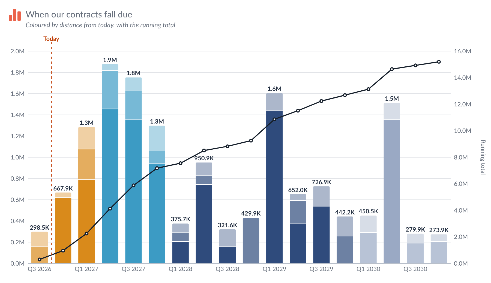
</p>

Amounts that fall due over time (contracts, leases and agreements by end date): one bar per week, month, quarter or year.

**Tiles:** `Maturity date` (1–3 date fields) · `Amount` (1 measure) · `Group` (1 dimension, optional) · `Item` (1 dimension, optional).

- Buckets by week, month, quarter or year (*Auto* picks the unit); optional **Overdue** and **Later** bars.
- Bars stacked by group; colours: one colour, one per group, or by **distance from today**.
- **Today** marker (or a fixed date), with the next N buckets shaded if you like.
- Optional **running total** line on a right axis.
- Click a bar or segment to select its dates (and group) in Tableau; the tooltip lists the top 5 items.

[Full documentation →](maturity-ladder/README.md)

## Parameter Switcher

<p>
  
  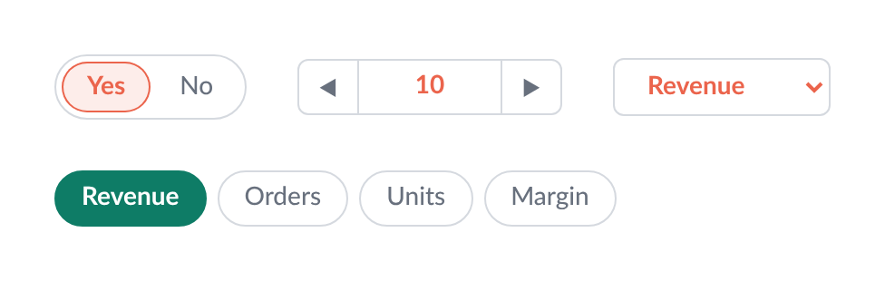
</p>

A control, not a chart: the allowed values of **one Tableau parameter** as tabs, buttons, pills, a dropdown, a toggle or a stepper, setting the parameter when one is clicked.

**Tiles:** `Options` (1 dimension, optional — the choices for a parameter that allows all values).

- Styles: **tabs**, **segmented** buttons, **pills**, **dropdown**, **toggle** (two choices), **stepper** (◀ value ▶).
- Always in step with Tableau: mirrors the parameter's current value, also when it changes elsewhere.
- Many choices switch to the dropdown automatically; tabs and pills otherwise scroll or wrap.
- Rename or hide a choice; colours for normal, hover and selected.
- Keyboard: arrow keys, Home / End, Enter or Space.

[Full documentation →](parameter-switcher/README.md)

## Narrative Card

<p>
  
  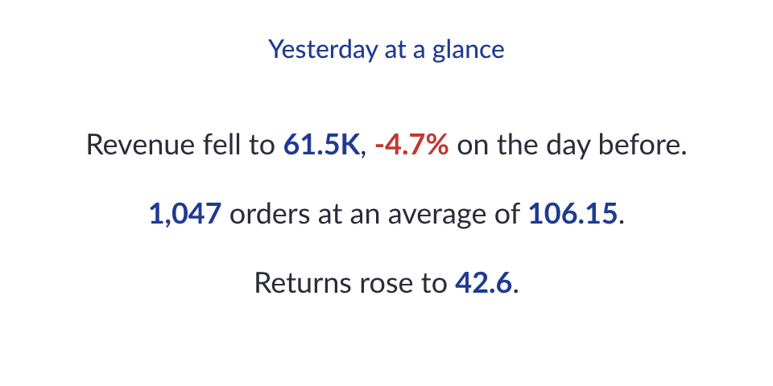
</p>

Sentences written by the dashboard builder, with live numbers inside: `{Revenue} this month, {Revenue.change} vs last month.`

**Tiles:** `Measures` (1–12) · `Date` (0–4 date fields, optional).

- Each measure is read like the **KPI Card**: latest value or month to date, compared with the previous date or the same day last month.
- Tokens for the value, change, difference, previous value, date and direction ("rose" / "fell"), with per-token overrides.
- **Conditions** (`{if Revenue.change > 0}…{else}…{end}`), bullets, bold and italic.
- Per-measure format, "increase is good" colours and arrows.
- Template tab lists the fields as buttons; a name that matches no measure shows in red.

[Full documentation →](narrative-card/README.md)

---

## Getting started in Tableau

1. Download the extension's `.trex` file from the table above (or from its folder).
2. In Tableau Desktop, on a worksheet, open the mark type menu on the Marks card, choose **Add Extension → Access Local Viz Extensions** and pick the `.trex`.
3. Drop fields on the extension's tiles on the Marks card, then click **Format Extension** to style it.

**Tableau Server / Cloud:** add `https://cobani.github.io/tableau_extensions/` to the extension safe list. That one entry covers every extension in this repo.

> After a `.trex` file changes (new version), remove and re-add the extension in the workbook.

## Repository layout

```
tableau_extensions/
├── shared/                  loaded by every extension, downloaded once and cached for all
│   ├── lib/                 Tableau Extensions API 1.17.0 (bundled, no CDN)
│   ├── fonts/               Lato 2.0 (OFL), WOFF2 + fonts.css
│   ├── core.js              helpers used by every extension (formatting, settings, data, selection)
│   ├── boot.js              start-up, automatic reload, error mark
│   ├── dialog.js / .css     Format dialog controls and base styles
│   ├── snapshot.js          picture export (PNG / SVG)
│   ├── theme.js, themes/    brand themes shared by all extensions
│   └── timing.js            load timings (?debug)
├── kpi-card/                one folder per extension (15 in all; the first seven are shown):
├── kpi-card-multi/            <name>.trex      manifest (Marks card tiles)
├── waterfall/                 index.html       the viz
├── line-chart/                chart.js / .css  data reading and drawing (KPI cards: card.js)
├── bar-chart/                 configure.*      Format dialog
├── matrix-table/              config.js        defaults, settings, number formatting
├── data-lineage/              icons.js, icons/ built-in icon set
│                              dev/             browser preview with sample data
│                              presets/         sample presets (all but line chart)
│                              CHANGELOG.md     what changed in each version
│                              examples/        README screenshots (made-up data)
├── serve.py / serve.sh      local server for all extensions (port 8766)
├── stamp-versions.py        cache-busting for GitHub Pages
├── release.py               every check in one command, version bump, changelog
├── tests/                   unit tests (node --test) and a browser smoke test
├── AGENTS.md, BACKLOG.md    how to work on this repo (people and AI models), planned work
└── index.html               landing page
```

Extensions share only what is in `shared/`, and everything there is covered by tests; everything else lives in the extension's own folder, so changing one extension never affects another.

## Local development

```bash
./serve.sh
```

Then open a browser preview with sample data, no Tableau needed (add `?debug` for load timings):

| Extension | Preview |
|---|---|
| KPI Card | http://localhost:8766/kpi-card/dev/preview.html |
| KPI Card Multi | http://localhost:8766/kpi-card-multi/dev/preview.html |
| Waterfall | http://localhost:8766/waterfall/dev/preview.html |
| Line Chart | http://localhost:8766/line-chart/dev/preview.html |
| Bar Chart | http://localhost:8766/bar-chart/dev/preview.html |
| Matrix | http://localhost:8766/matrix-table/dev/preview.html |
| Data Lineage | http://localhost:8766/data-lineage/dev/preview.html |
| Sankey | http://localhost:8766/sankey/dev/preview.html |
| Funnel | http://localhost:8766/funnel/dev/preview.html |
| Bullet & Gauge | http://localhost:8766/bullet-gauge/dev/preview.html |
| Cohort Grid | http://localhost:8766/cohort-grid/dev/preview.html |
| Treemap & Donut | http://localhost:8766/treemap-donut/dev/preview.html |
| Maturity Ladder | http://localhost:8766/maturity-ladder/dev/preview.html |
| Parameter Switcher | http://localhost:8766/parameter-switcher/dev/preview.html |
| Narrative Card | http://localhost:8766/narrative-card/dev/preview.html |

The local server also lists your Tableau shape palettes (from *My Tableau Repository* and the Tableau Desktop install) for the icon pickers. Python 3 standard library only.

Checks before committing (one command; it also refreshes the cache-busting stamps):

```bash
npm install          # once: ESLint only, the extensions themselves have no dependencies
python3 release.py   # syntax, manifests, stamps, lint, unit tests
```

GitHub Actions runs the same checks on every push, plus a browser test that opens every extension and every tab of its Format dialog with sample data. Working rules, recipes and the order of work for contributors (people and AI models) are in [AGENTS.md](AGENTS.md); planned work is in [BACKLOG.md](BACKLOG.md).

## Deploying

Hosted on GitHub Pages from `main` (root): `https://cobani.github.io/tableau_extensions/<extension>/`.

1. `python3 release.py` runs the checks and adds content hashes to every script and stylesheet link, so browsers never mix old and new files. For a user-visible change, first `python3 release.py bump <extension> patch "What changed"` (raises the version in the `.trex` and adds the line to that extension's `CHANGELOG.md`). Bar Chart: run `python3 bar-chart/bundle_shapes.py` first if the bundled shape palettes changed.
2. Commit and push to `main`.

## Author

**Ilyas Coban** · [LinkedIn](https://www.linkedin.com/in/ilyascoban/)
