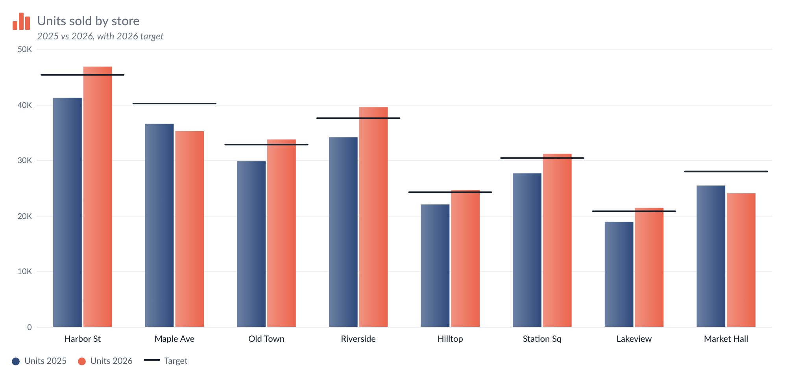
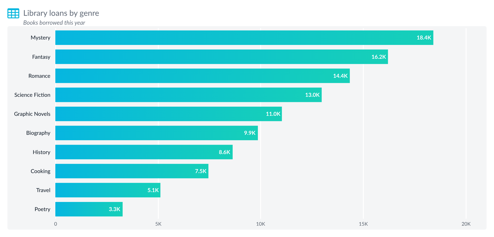
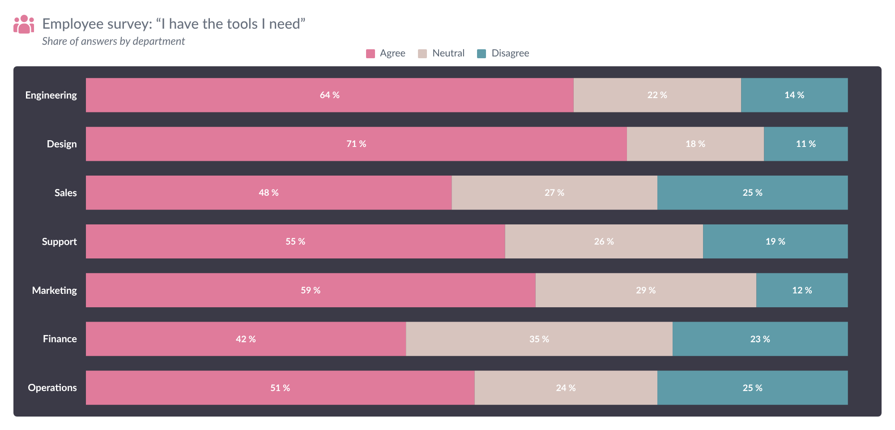
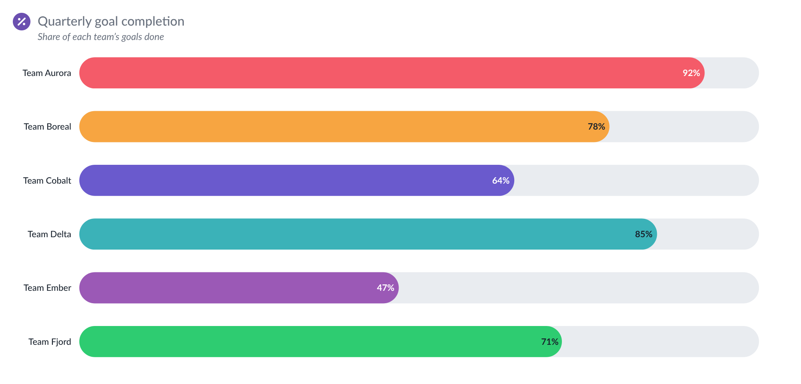
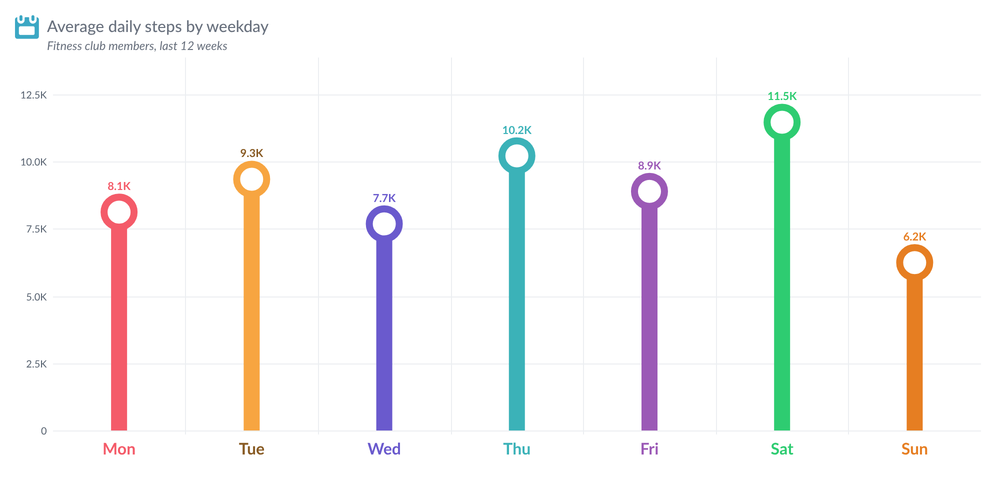

# Bar Chart — Tableau Viz Extension

A bar chart for every common bar design: vertical or horizontal, grouped, stacked, 100% stacked, left-right
comparison and overlapping bars, as plain bars, lollipops or filling (progress) bars, with a line on top, targets,
reference lines, icons per member, comments, Top N with *Others*, and drill-down on double-click. The icon, title and
explanation are the same as **KPI Card**; the card options and number formatting are the same as **Waterfall**.

<p>
  
</p>
<p>
  
  
</p>
<p>
  
  
</p>

```
bar-chart.trex   manifest: Marks card tiles + "Format Extension" button
index.html       chart page
chart.css        chart styles
chart-state.js   shared state (window.BcChart.S) and constants; loaded first
chart-data.js    reading Tableau data, Top N, sorting, drill, colours (the view model)
chart-layout.js  scales, axis ticks, text measuring, label placement, legend items
chart-card.js    card style, header, drill breadcrumb, legend
chart-draw.js    the svg plot: bars, lollipops, segments, lines, labels, comments
chart-interact.js tooltip, hover, click/select, drill, right-click menu, comment editor, live preview
chart.js         start-up, refresh, paint, resize, opening the Format dialog (loaded last)
configure.*      Format dialog (every option below)
config.js        shared defaults, number and date formatting, colour palettes
icons.js, icons/extension/ the 14 Figma icons from *Icons for Extension* (same files as KPI Card)
../shared/ API library, Lato fonts and timing.js, shared by every extension in the repo
../serve.sh    local server (repo root) on :8766, also lists Tableau shape palettes (yours too)
bundle_shapes.py copies Tableau's built-in shape palettes into shapes/ for GitHub Pages
shapes/          bundled shape palettes + index.json (Icon and Member icons → Tableau shapes)
dev/             browser preview with sample data (no Tableau needed)
```

The builder guide (`Bar Chart - Builder Guide.pptx`) and `Development Resources/` stay out of git.

## Run it

```bash
cd .. && chmod +x serve.sh && ./serve.sh     # from the tableau_extensions repo root
```

In Tableau Desktop (2024.2+): Marks card → mark type dropdown → **Add Extension** → **Access Local Extensions** →
`bar-chart.trex` (in the `tableau-extensions` folder; it loads the extension from GitHub Pages).

To try it without Tableau, open <http://localhost:8766/bar-chart/dev/preview.html>. It has twelve sample data sets (three Dimension
fields + line + target, dates, two and three measures, 100% stacks, ratios, negatives, Category › Sub-Category, Age group › Gender, raw large
numbers, Measure Names, 25 countries for Top N) and opens the Format dialog next to the chart.

Tableau allows a viz extension at most **four** tiles of its own. Tableau's own **Tooltip** tile is always on the Marks
card too; every field there becomes a `name: value` tooltip row.

| Marks card tile | What to drop | Drives |
| --- | --- | --- |
| **Dimension** | 0–6 dimensions, outermost first (e.g. Category, Sub-Category, Region) | the first ones make the bars (Chart type → *Bars are*, default the first field; outer ones group the bars). The rest are the **breakdown**: tooltip rows, bar segments and drill-down levels. Empty = one bar per measure |
| **Measure** | one or more measures, dropped **one at a time** | the bar lengths. Two or more measures stand side by side, stack, or compare left-right |
| **Line** | up to 4 measures (optional) | lines over the bars, on the bars' axis or their own |
| **Target** | one measure (optional) | a target marker on every bar; progress bars can fill up to it |
| **Tooltip** (Tableau's) | any fields (optional): dimensions or measures, discrete or continuous | `name: value` rows in the tooltip, in tile order (several values: the first three and “+N more”) |

- **Axis shows** (Grouping, Breakdown & Drill tab): automatic, dimension, date or Measure Names. Dates are sorted and labelled as dates
  (Jan 2026, Q1 2026 …). Measure Names makes one bar per measure; Dimension fields then group them.
- Values from finer rows (breakdown fields, dimensions on Detail) are **added up** per bar. For averages and ratios, use
  measures that aggregate correctly at the bar level, and set *Others* to *Average*.
- **Field roles** (Grouping, Breakdown & Drill tab): set every Dimension field to Bars to show every value at once (outer
  fields group the bars), no double-click needed.
- **Split bars**: set any Dimension fields to *Split bars* and their values split each bar (like dimensions on Tableau's
  Color; several fields combine, e.g. “West · Consumer”); with none, the measures split the bars. *Automatic split*
  uses the last field when there's one measure and the layout is stacked, 100%, left-right or overlapping. Left-right
  needs exactly two values (more alternate sides). Which side each value takes (Chart Type → Left-right comparison →
  *Sides from*): **the data order** — measures in their Measure tile order, Dimension values in the worksheet's sort
  order, the first going left / down (or right / up) — or **Pick each value's side** to set Left / Right per value.
- **"Each bar is"**: Bars → Highlighted bars and Member icons let you say what a bar's name is — its own name,
  its measure name, or the value of any Dimension field (e.g. one icon per Category, shared by its Sub-Categories).
- If Tableau delivers the measures as *Measure Names / Measure Values*, the extension pivots them back.
- The **same field on two tiles** (e.g. Sales on Measure and Line, or Region on Dimension and Tooltip) is read for both;
  nothing is hidden because it appears twice.

## In the chart

- **Hover** a bar: tooltip with the full value, % of total, % of the category, change vs the previous bar, target and
  % achieved, the breakdown (or every series of the category), line and Tooltip-tile values, and comments. Other bars
  fade.
- **Click** a bar, its value label or its name on the axis: selects that category in Tableau (for dashboard filter and
  highlight actions) and fades the other bars. Click it again, or on empty space, to undo; click another one to select
  that instead. Optionally (Tooltip & actions, off by default) the click also pins the tooltip, which lists every row
  and sorts by *Name* or *Value*.
- **Tableau's own tooltip** (Tooltip & Actions, off by default): hovering shows the tooltip you designed in Tableau
  (Worksheet → Tooltip, including viz in tooltip) instead of this one. Needs Tableau 2024.2 or newer; older versions
  keep the extension's tooltip. A stacked segment shows the tooltip of its row; a bar total, an *Others* bar or a line
  point shows the first row behind it.
- **Save as picture**: the export button's menu also has *Picture (PNG)*, which saves the whole card (title, legend and
  chart). Switch it off on the Export tab (*Save as picture button*).
- **Double-click** a bar: drill down into the next Dimension field. Three modes (Breakdown & drill tab):
  *expand that bar and keep the others*, *show only that bar's detail*, or *expand every bar*. A Back / Reset bar
  appears above the chart.
- **Right-click** a bar: format its colour, add a comment, drill down / up / collapse, keep only, hide, highlight,
  and quick links to the Format tabs. Viz extensions can't add to Tableau's own right-click menu, so this is the
  extension's own menu.
- **Legend**: click an item to hide / show it, hover to highlight it.
- **Comments**: right-click → *Add comment*. They're saved in the workbook (while authoring), shown as a marker (dot,
  flag, pin, bubble) or a callout, and listed in the tooltip and on the Comments tab.

### Dated event markers

With a **date** on the Dimension tile, mark moments such as a launch or a price change: *Format → Gridlines & Target →
Events → Add event* (date, label, colour). Each event is a dashed line across the plot at the bar whose date period
holds the event date (a vertical line with vertical bars, a horizontal one with horizontal bars) and a short label at
the edge of the plot. Labels never overlap or leave the plot (up to three rows, then they are shortened with “…” and
the full text is in the hover). Hover the line to see the label and date. Events outside the dates shown, and any
event on a non-date axis, are not drawn. The list is empty by default, so nothing changes for existing charts.
Line colour, style, label size and label side are in the same group.

### Small multiples

Format → *Grouping, Breakdown & Drill* → **Small multiples**: *Split by* a Dimension field draws one chart per value,
each with its own title. Options: arrange (grid, one under another, side by side), *Panels per row* (0 = automatic),
*Minimum panel width* (with automatic columns: as many columns as fit panels at least that wide, e.g. 220 px; 0 = the
older rule based on the chart's shape), space between panels, *Same value axis in every panel*, *Axis labels on the
outer panels only* (value labels on the first column, dimension labels on the last row, when the axis is shared),
panel title size, weight, colour and alignment, and *Show at most (panels)*, which keeps the first N panels and adds
the note “Showing N of M panels” (0 = all). Every new option defaults to the previous behaviour.

## Format dialog

**Format Extension** at the bottom of the Marks card, or right-click the chart. The dialog is modeless, so the chart
updates as you change things. **Cancel** undoes everything since the dialog opened; **Reset tab** restores that tab's
defaults.

**Undo and search.** The **↶ / ↷** buttons in the footer (or Ctrl/Cmd+Z and Ctrl/Cmd+Shift+Z) step back and forward through your changes in this dialog; a slider drag or a typed number counts as one step. The search box above the tabs finds a setting on any tab: type two or more letters, click a result, and the dialog opens that tab and highlights the setting.

| Tab | Options |
| --- | --- |
| Icon | as KPI Card: built-in icons (default: bar chart) or **upload** — an upload becomes a one-colour shape like the built-ins, so Size and Icon color apply |
| Title | as KPI Card: show, text (empty = "Measure by Dimension field"; `<Parameter name>` shows a parameter's value), alignment, font, size, weight, colour, italic; explanation with *Keep space when empty* |
| Chart Type | **Quick looks** (22 one-click designs) · orientation · layout (regular, stacked, 100%, left-right / up-down, overlapping) · style (bar, lollipop, filling / progress — fill up to 100%, the largest bar, the total of all bars, the Target, a measure on the Detail tile or a fixed value) with their settings |
| Bars | **show / hide the bars** · width and gaps · end shape and corners · **Bar color**: colour by one colour, measures, dimensions, positive / negative or highlight, palette (double-click a swatch to edit), fill (solid, gradient, two-tone), opacity · colours per measure / value · highlighted bars · colour rules · border · shadow · hover fade · clipped-bar marker · grow animation |
| Dimension Axis | category names: on the axis, in pills, inside or beyond the bar · side, direction, max lines, skip overlapping names, title, font, colour like the bar, pill radius |
| Measure Axis | range (starts at zero / close to the data / fixed, ends at, ticks, reversed) · labels (side, title, font) |
| Value Text | value labels (place — also *inside the lollipop head* —, content, which bars, distance) · overlapping labels · text · badges · stacked segment labels and totals (optional “Total” legend item) · **one number format for the whole chart** · chart font · null values · **field names** (default, custom or a parameter's value) |
| Member Icons | an icon per bar (by name, measure or a Dimension field's value): place, size, background, colour, fallback |
| Grouping, Breakdown & Drill | **one row per Dimension field** with its role — *Bars* (the first fields; outer ones group them), *Split bars* (its values split each bar, like a dimension on Color; several combine), *Breakdown* (segments, tooltip, drill-down) or *Panels* (one chart per value — small multiples, like a dimension on Rows / Columns: grid, one under another or side by side, shared value axis, panel titles); with 2+ measures a **Measure Names** row: *Bars* (one bar per measure), *Split bars* (the measures split each bar) or *Panels* (one chart per measure, each with its own axis; combines with Panels fields) — and a summary of what the chart does · Automatic split · axis type · group labels (style tucked away) · segments · drill-down (3 modes) |
| Gridlines & Target | measure and dimension axis lines · value gridlines · lines between categories · zero line · target markers · reference lines and bands · **Events** (dated markers, see below) |
| Sort & Top N | sort · Top N of any Dimension field, within each parent or overall, by any measure, with Others |
| Legend | position, order, markers, totals, included items, Top N naming, item names, title, text, interaction, box |
| Line Chart | **show / hide the lines** · per Line measure: name, colour, shape, markers, values · shared or own number format for line values + line axis · line axis |
| Tooltip & Actions | **use Tableau's tooltip** · tooltip parts, sorting, rows, pin on click · **own number format** (else the chart's) · right-click menu · double-click · click selects in Tableau |
| Comments | show, marker or callout, style, author · edit, recolour, delete, add |
| Card | padding, space above the chart (default 0), background and chart-area background |
| Presets | export, import and save chart settings · apply or save a brand theme (colours and fonts, shared by every extension) |

### Quick looks

Each one sets the look of a reference design in one click and keeps your data, member colours, icons and sorting:
**Default preset** (your saved default look) and **Default** (the extension's own defaults) first, then shaded by value, gradient rows, stacked rows, left-right comparison, ranking with icons, ranked list
with the axis on top, names inside the bars, 100% rows on a dark panel, rounded overlapping bars, filling tubes,
lollipops with rings, hexagon value badges, icons with two-tone bars, value pills, grouped soft gradient, highlight +
median line, table with bars, bars + line with diamond labels, slim bars with tags, outlined pills with ring labels and
progress rows. Fine-tune any of them on the other tabs.

## Settings and deploying

Everything is stored in the workbook under one settings key. Series, line and member settings are stored by name
(e.g. `SUM(Sales)`, `West`), so renaming a pill or a member starts that item from the defaults. Renamed pills are still
matched to their data columns by position.

1. The Tableau Extensions API library is bundled in `../shared/lib/tableau.extensions.1.17.0.min.js` (shared by all extensions, no CDN).
2. Run `python3 release.py` (repo root) before every commit: all checks plus cache-busting for GitHub Pages.
3. Host the folder over HTTPS (GitHub Pages: `Cobani/tableau_extensions`, folder `bar-chart/`) and check `<source-location><url>` in
   `bar-chart.trex`.
4. Add the URL to the Tableau Server extension safe list. `dev/` doesn't need to be deployed.

Tableau reads the `.trex` only when the extension is added, so after editing it, remove the extension and add it again.

### Presets

Presets (Format → Presets) store only the settings that differ from the defaults, with a format `version`. Shared
presets live in `presets/`: `Hexagon-Lollipop.json`, and `Single-Stacked-Bar.json` — one horizontal bar split by
every Dimension field (`chart.seriesBy: "all"`), so it works on any sheet. When the extension changes:

- a new option needs nothing: presets without it get its default;
- a setting tied to the sheet's fields or members goes into `FIELD_PATHS` (left out of *Look only* presets);
- a renamed or moved setting bumps `PRESET_VERSION` and gets a step in `PRESET_MIGRATIONS` (`cparts/c4b.js` →
  `configure.js`), and the files in `presets/` are re-saved in the new version.

### Performance

- **Live preview**: the Format dialog sends each change straight to the chart (through the browser's local storage —
  both come from the same site), so the chart redraws at once; Tableau saves the settings a moment later, one save
  at a time. If the dialog is closed before its last save, the chart saves its settings itself.
- **Hover**: handled once per animation frame; moving inside a bar only moves the tooltip; the fade uses a prebuilt
  index of the chart's elements and only touches what changes; crossing the gap between bars doesn't reset the fade.
- **Big charts** (more than about 300 bars): no grow animation and no fade transitions.
- Number formatters, text widths and parsed dates are cached.
- `dev/preview.html` → *Stress test* data (`index.html?mock&data=big&n=400` = 16,000 rows) to check speed.

### Load timings (debug)

In DevTools, pick this extension's frame in the Console, run `localStorage.setItem('extDebug', '1')` and reload. Each
load prints a table of steps and files. `extTimings()` prints it on demand; `localStorage.removeItem('extDebug')`
turns it off. In the dev preview, add `?debug` to the URL.

## Data limit, errors and privacy

- **Maximum rows.** The extension reads at most 1,000 rows from the worksheet by default. Change it in *Format → Card → Maximum rows* (0 = all rows). When rows are left out, a note in the bottom-left corner says "Showing the first N rows".
- **Errors.** If something goes wrong, a small **!** mark appears in the bottom-right corner. Click it for details you can copy (extension version, Extensions API version, the error) and a Reload button.
- **Nothing is kept in the browser.** The chart is always drawn from live worksheet data; no data is stored between visits.
- **What changed in each version:** [CHANGELOG.md](CHANGELOG.md).
