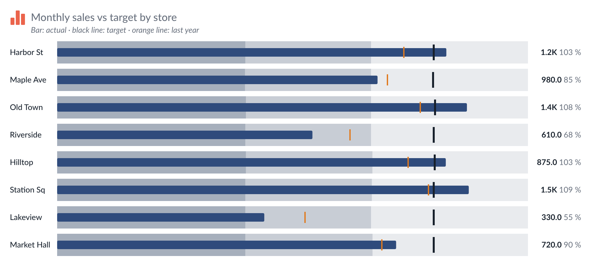
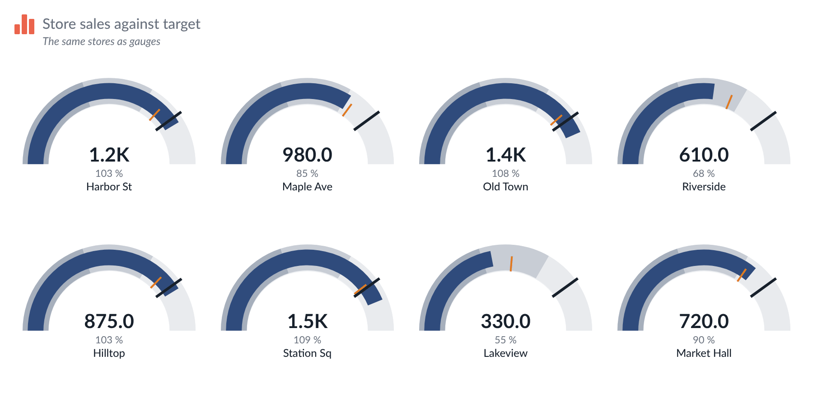

# Bullet & Gauge — Tableau Viz Extension

Actual against target, with qualitative ranges (poor / OK / good). One mark per category, drawn as **bullet rows**
(default), **gauges** or **progress bars**. The icon, title, explanation and card options are the same as in the other
extensions, and so is the number formatting.

<p>
  
</p>
<p>
  
</p>

```
bullet-gauge.trex   manifest: Marks card tiles + "Format Extension" button
index.html          chart page
chart.css/js        header, data reading, drawing, tooltip, right-click menu
configure.*         Format dialog (every option below)
config.js           shared defaults, number formatting
icons.js, icons/    the Figma icon set (same files as the other extensions)
../shared/          API library, Lato fonts and helpers shared by every extension in the repo
dev/                browser preview with sample data (no Tableau needed)
```

## Marks card tiles

| Tile | What to drop | Drives |
| --- | --- | --- |
| **Category** | 0–2 discrete dimensions (optional) | one row / gauge per member. Empty: one mark for the whole worksheet |
| **Actual** | one measure (required) | the bar or arc |
| **Target** | one measure (optional) | a tick, and the % of target |
| **Ranges** | up to three measures, **dropped one at a time** (optional) | the upper limits of the bands, e.g. Poor / OK / Good limits |
| **Comparison** | one measure (optional) | a thin tick, e.g. last year |

Measures are summed over the rows of a category. Rows are shown in the order of the data unless you sort them.

## What it draws

- **Bullet rows.** A label column, bands in tints of one colour (or three colours), a thinner actual bar, a target tick,
  a thin comparison tick and the value with its % of target at the right. Negative actuals extend to the left of a zero line.
- **Gauges.** A grid of semi-circular gauges (columns follow the width): band arcs, a thick actual arc, the target tick
  on the arc, the big value in the middle, the label under it. A gauge stops at zero for negative actuals but shows the real number.
- **Progress bars.** A rounded bar per category filled to Actual / Target, with the percentage.
- **Bands.** From your Ranges measures. Without them, bands end at percentages of the target (default 60 / 85 / 100 %, editable);
  with no target either, at percentages of the largest value.
- **Status colours.** The actual bar can turn red / amber / green by % of target (thresholds editable).
- **Lower is better.** Reverses the band colours and the status colours (costs, errors, wait times).
- Many categories: **Top N** and **Sort by** (data order, actual, % of target). Without Top N at most 500 are drawn and a note says so.
  A zone that is too small for all rows or gauges scrolls.

## Formatting

Two ways in: the **Format Extension** button at the bottom of the Marks card, or **right-click / double-click** a row or gauge.
The Format window opens on top of Tableau, and the chart behind it updates live. **Cancel** undoes everything since it opened;
**Reset tab** restores that tab's defaults. The **↶ / ↷** buttons (or Ctrl/Cmd+Z) undo and redo; the search box finds a setting on any tab.

| Tab | Options |
| --- | --- |
| **Icon** / **Title & text** | as in the other extensions |
| **Chart** | Show as (bullet / gauge / progress), row height or smallest gauge width, spacing, sort, Top N, tooltips, right-click menu, *Click selects in Tableau*, *Use Tableau's tooltip* |
| **Scale** | each row its own scale or one shared scale; maximum automatic or a fixed number (always starts at zero) |
| **Ranges** | Ranges measures or % of target, the three thresholds, tints of one colour or three colours, lower is better |
| **Actual & target** | actual colour (one, or by status with thresholds), thickness, radius; target and comparison tick colour and thickness |
| **Labels** | category and value fonts, show % of target, widest label column |
| **Numbers** | number format of values (K / M / B, decimals, unit, negatives), format of the % of target |
| **Card** | padding, background, divider, *Save as picture* button, Maximum rows |
| **Presets** | export / import, My presets, Brand theme |

- **Click selects in Tableau** (on by default): click a row or gauge to select its category, so dashboard filter and highlight
  actions fire. Click again, click an empty area or press Escape to clear. Needs a Category.
- **Tableau's own tooltip** (off by default): shows the tooltip designed in Tableau (Worksheet → Tooltip) for the category's first row.
  Needs Tableau 2024.2 or newer; otherwise the extension's own tooltip (category, actual, target, % of target, comparison, each range limit) is used.
- **Save as picture** adds a button in the top-right corner (on hover) that saves the chart as a PNG.

## Presets

The last tab saves and loads every setting. **Export** as "Look only" (leaves out title and explanation text and the row limit) or "Everything".
Sample files to import (Import → Choose file): `presets/Default.json` and `presets/Dark-gauges.json` (dark card, three-colour bands, status colours, gauges).
**Brand theme** applies a colour and font theme shared by all extensions.

Settings are stored in the workbook under the key `bulletGauge1`; new settings always default to the old behaviour.

## Data limit, errors and privacy

- **Maximum rows.** The extension reads at most 1,000 rows from the worksheet by default. Change it in *Format → Card → Maximum rows* (0 = all rows). When rows are left out, a note in the bottom-left corner says "Showing the first N rows".
- **Errors.** If something goes wrong, a small **!** mark appears in the bottom-right corner. Click it for details you can copy and a Reload button.
- **Nothing is kept in the browser.** The chart is always drawn from live worksheet data; no data is stored between visits.
- **What changed in each version:** [CHANGELOG.md](CHANGELOG.md).

## Run it locally

```bash
cd .. && ./serve.sh     # from the tableau_extensions repo root
```

Open <http://localhost:8766/bullet-gauge/dev/preview.html>. Six sample data sets: 8 stores with every tile, no category (one mark),
actual + target only, negatives / zero targets / nulls, 1,200 categories, and renamed pills. The Format window opens next to the chart.
Add `?debug` to the chart URL for load timings.

In Tableau: Marks card → mark type → **Add Extension** → **Access Local Extensions** → `bullet-gauge.trex`. After any `.trex`
change, remove the extension from the worksheet and add it again.
