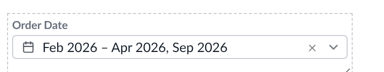
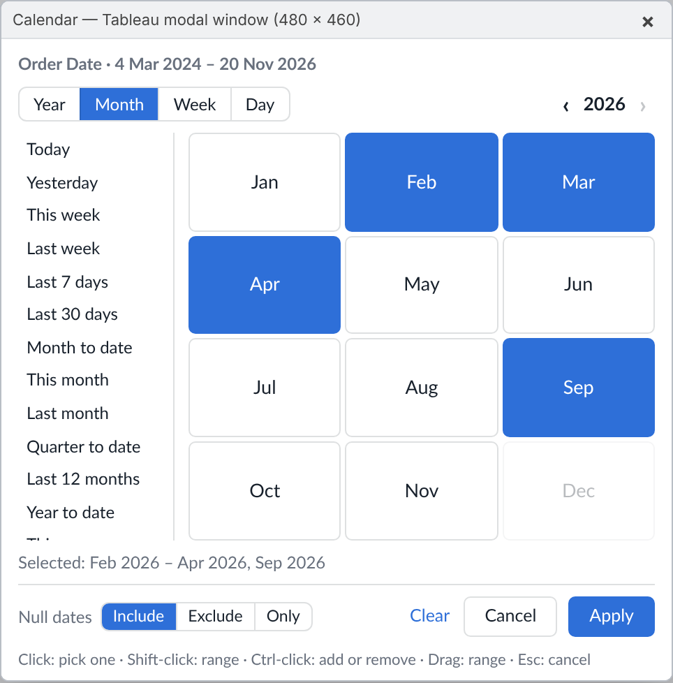

# Calendar Filter

  
  

A date filter for Tableau dashboards. The extension zone shows one **text box** with the dates
chosen ("Feb 2026 – Apr 2026, Sep 2026"). Clicking it opens a **calendar window** — Tableau's own
dialog window, so it is not limited to the size of the zone — where people pick years, months,
weeks or days, single values, ranges or several values, quick ranges such as *Month to date*, and
whether rows with a **null date** are included.

The choice is written into the **date filter on the sheet's Filters shelf**, so it shows in the
Filters pane like any other filter, is saved with the workbook and in custom views, and filters
every sheet the filter is applied to. The calendar always shows every date between **Start date**
and **End date**.

Data used in the examples is made up.

## Set it up (once per dashboard)

1. **Worksheet.** Add the extension to a new worksheet (Marks card → *Viz Extension* →
   `calendar-filter.trex`).
2. **Start date and End date tiles.** Make two calculated fields and drop them on the tiles, as
   exact dates:
   - `Start date` = `{MIN([Onboarding Start Date])}`
   - `End date` = `{MAX([Onboarding Start Date])}`

   They must be FIXED calculations (the `{ }` form): those are worked out before the date filter,
   so the calendar keeps showing every date between them while the filter narrows the sheet.
3. **Filters shelf.** Drag the date itself (`Onboarding Start Date`) to the **Filters** shelf of
   the same sheet and choose either
   - **Exact Date** (Individual dates) — allows any days: several values, ranges and null dates, or
   - **Range of dates** — holds one continuous range (picks in between are filled in).

   Right-click the filter → **Apply to Worksheets → All Using This Data Source** (or *Selected
   Worksheets*), so it filters the dashboard. Show its filter card if you like; it stays in step.
4. **Dashboard.** Put the worksheet on the dashboard. A short zone is enough (about 40 px high with
   the title, 22 px without).

That's it: click the text box, pick dates, press **Apply**. The filter in the Filters pane changes;
a change made in the Filters pane (or a reset, or a custom view) shows up in the text box too.

## Using it

| In the calendar window | Does |
|---|---|
| Click | Pick one period (click it again to clear) |
| Shift-click | A range from the last click |
| Ctrl-click (⌘ on Mac) | Add or remove one period |
| Drag across cells | A range |
| Year / Month / Week / Day | Switch granularity (clears the selection) |
| Quick ranges | Today, Yesterday, This / Last week, Last 7 / 30 days, Month to date, This / Last month, Quarter to date, Last 12 months, Year to date, This / Last year |
| Null dates: Include / Exclude / Only | Keep, drop, or show only the rows that have no date |
| Greyed days | Before Start date or after End date (can't be picked), or no data in the filter's list of dates |
| Clear | All dates, nulls back to the default |
| Apply · Cancel · Esc | Filter the dashboard · leave it as it was |

The same line of help is shown at the bottom of the window, written for the click behaviour chosen in
Format. The × in the text box clears the filter without opening the calendar.

Weeks show their number (**W47**). Week 1 is the week that holds 1 January, like Tableau's
`WEEK()`; weeks start on Sunday unless Format → Calendar says otherwise.

## Format Extension

| Tab | Settings |
|---|---|
| **Text box** | Title above the box (field name, custom text or none) and its font · text when nothing is filtered · × clear button · calendar icon · height (20 px by default), corners, colours, font |
| **Window** | Filter the dashboard *On Apply* or *Live, on every click* · window size (Small / Medium / Large) · on top of Tableau or floating · how-to line |
| **Calendar** | Date filter to set (when the Filters shelf has several) · week starts on (Sunday, Monday, Saturday) · which granularities are offered · opens at (default **Day**) · days of the next / previous month · click behaviour (Standard, Toggle, Single value, Range only) · drag to select · periods with no data clickable or not · null dates control and default |
| **Quick ranges** | Where they appear (list on the left, dropdown, chips, off) · count back from today or from the latest date in the data · which ones are listed |
| **Look** | Accent colour (any colour or hex code) · font and colours of the window · zone padding and background |
| **Presets** | Export / import / My presets for all these settings, and brand themes |

### Good to know

- **Exact Date or Range of dates.** With Exact Date the calendar writes the list of days (several
  values and nulls work). With a range of dates it writes one range and the null option
  (Include → all values, Exclude → non-null, Only → null values); Ctrl/⌘-click is not offered.
- **Only days with data can be listed** in an Exact Date filter (Tableau has no value for the
  others). Days without data are greyed; picking only such days clears the filter and the box says so.
- **Where the window opens** is decided by Tableau (usually the middle of the Tableau window). An
  extension can't place it under the text box.
- **Live mode** sends each click to the filter while the window stays open. On Tableau versions
  whose Extensions API has no dialog messages, the choice is applied when the window closes.
- Viewers can use the filter on Tableau Server; only authors can change the Format settings.

## Preview without Tableau

`./serve.sh` in the repo folder, then <http://localhost:8766/calendar-filter/dev/preview.html>.
The preview has made-up data sets (Exact Date and Range-of-dates filters, date-times, no nulls, and
the set-up messages) and shows the filter as the Filters pane would.
