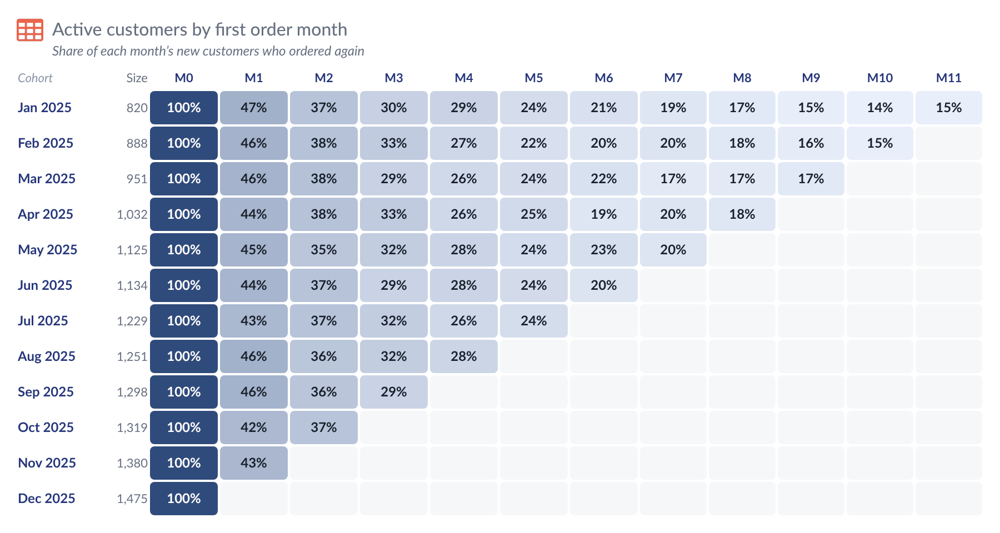
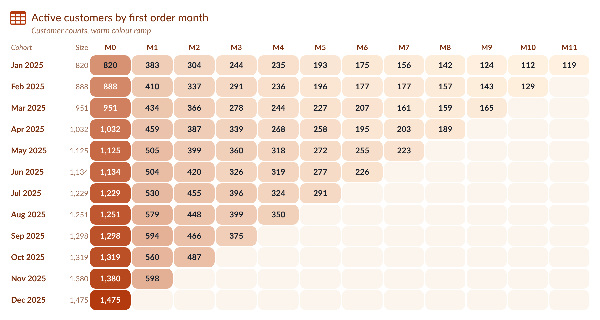

# Cohort Grid — Tableau Viz Extension

A retention (cohort) triangle: one row per cohort (first-order month, sign-up week …), one column per period since the cohort
started (0, 1, 2 …), every cell shaded by its value, as a number or as a percentage of the cohort size. Part of the
`tableau_extensions` repo (shared files in `../shared/`).

<p>
  
</p>
<p>
  
</p>

## Run it

```bash
cd .. && chmod +x serve.sh && ./serve.sh     # from the tableau_extensions repo root
```

In Tableau Desktop (2024.2+): Marks card → mark type dropdown → **Add Extension** → **Access Local Extensions** → `cohort-grid.trex`.

To try it without Tableau, open <http://localhost:8766/cohort-grid/dev/preview.html>. It has seven sample data sets (`?data=`):
`default` (12 monthly cohorts, numeric period), `dates` (period as a month date), `weekly` (20 × 20, no cohort size), `small`
(4 × 4), `gaps` (missing cells, zeros, a cohort of size 0), `big` (50 × 50, shows the row note) and `renamed` (renamed pill), and
it opens the Format dialog next to the grid.

## Marks card tiles

| Marks card tile | What to drop | Drives |
| --- | --- | --- |
| **Cohort** (required) | one dimension | the rows: first-order month, sign-up week … Dates sort as dates |
| **Period** (required) | one dimension: a number (0, 1, 2 …) or a date | the columns: time since the cohort started |
| **Value** (required) | one measure | what each cell shows and is shaded by |
| **Cohort size** (optional) | one measure | the denominator of the percentages. Empty = the value in period 0 |

- A **number** on Period is the period index itself. A **date** on Period is counted in months, weeks, days, quarters or years from
  the cohort's date (*Format → Values → Date periods count in*; automatic uses the smallest gap in the data). Rows before the cohort are ignored.
- A cell with no row is **empty**, not zero. A zero is shown as a zero. A cohort of size 0 has no percentages.

## What it draws

- **Cells show**: % of cohort size (retention, default), the value, or % of the previous period. Decimals, hide period 0, text for empty / zero cells.
- **Heat map**: a light-to-dark ramp (or one colour); lowest and highest value automatic or fixed; one scale for the whole grid or for each cohort;
  text turns white on dark cells.
- **Layout**: narrowest column, row height, gap and rounded corners; the first column holds the cohort label and its size; an optional
  **Average** row at the top or bottom; frozen headers when the grid scrolls.
- **Sort and limits**: cohorts oldest or newest first, last N cohorts only, first N periods only. Period headers from a template: `M{n}`, `Month {n}`, `+{n}`.
- **Click** a cell to select its cohort and period in Tableau; click a cohort label to select the cohort. **Tooltip**: cohort, period, value,
  cohort size, % of cohort size, % of previous period and the change from the previous period.
- **Export** (button on hover, right-click menu): Excel and CSV of the grid as shown, Excel and CSV of the data (one row per cohort and period),
  copy to the clipboard, and Save as picture (PNG).

## Format dialog

Icon · Title & text · **Values** · **Heat map** · **Layout** · **Sort & limits** · **Headers** · Tooltip & actions · Export · Numbers · Card · Presets.
Right-click or double-click a cell or header to jump to its settings. The window stays on top of Tableau and the grid updates live.

## Presets

The last tab saves and loads every setting. **Export** "Look only" leaves out the title, explanation and file name. It also has
**Brand theme** (shared by all extensions). Samples: `presets/Default.json` and `presets/Warm.json`.

## Settings and deploying

Everything is saved in the workbook under one settings key (`cohortGrid1`).

1. The Tableau Extensions API library is bundled in `../shared/lib/` (no CDN).
2. Host the repo over HTTPS and change `<source-location><url>` in `cohort-grid.trex`.
3. Add the URL to the Tableau Server/Cloud extension safe list. `dev/` doesn't need to be deployed.

Tableau reads the `.trex` only when the extension is added, so after editing it, remove the extension and add it again.

### Load timings (debug)

Open DevTools, pick this extension's frame, run `localStorage.setItem('extDebug', '1')` and reload to see where load time goes.

## Data limit, errors and privacy

- **Maximum rows.** The extension reads at most 1,000 rows from the worksheet by default. Change it in *Format → Card → Maximum rows* (0 = all rows). When rows are left out, a note in the bottom-left corner says "Showing the first N rows". A 50 × 50 triangle has 1,275 rows, so raise the limit for it.
- **Errors.** If something goes wrong, a small **!** mark appears in the bottom-right corner. Click it for details you can copy (extension version, Extensions API version, the error) and a Reload button.
- **Nothing is kept in the browser.** The grid is always drawn from live worksheet data; no data is stored between visits.
- **What changed in each version:** [CHANGELOG.md](CHANGELOG.md).
