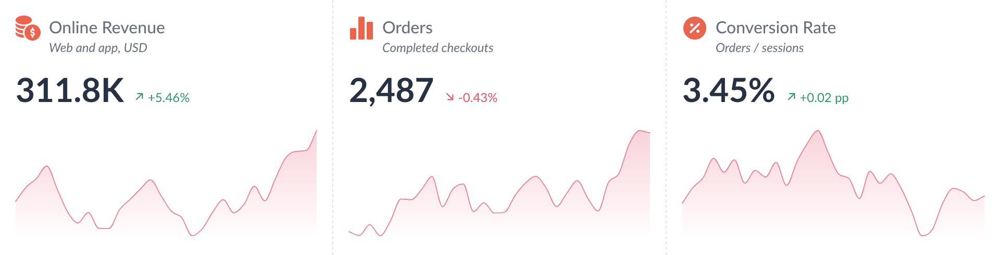
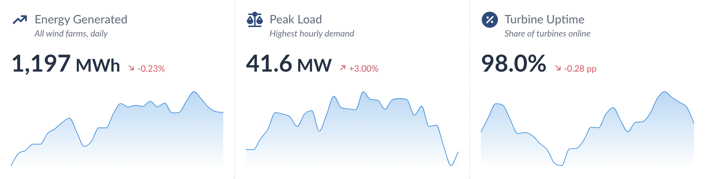

# KPI Card Multi — Tableau Viz Extension

By [ilyas coban](https://www.linkedin.com/in/ilyascoban/).

<p>
  
</p>
<p>
  
</p>

Several KPI cards in **one** extension zone. Each measure on the **Measures** tile becomes a card that looks and works
like the single KPI Card (Figma *KPI Card 3*): icon, title, explanation, big number with unit, % / pp change, trend
line or "vs previous period" text.

**Why:** Tableau Server checks and starts every extension zone separately, through one queue for the whole dashboard.
With 11 single KPI Cards it sometimes answered its permission check (`getExtensionLoadStatus`) with
`{"errors":[{"code":0}]}` and never created that card's frame (seen often in Firefox). One KPI Card Multi zone with 6
measures needs 1 permission check, 1 handshake and 1 data request instead of 6 of each.

```
kpiCardMulti.trex  manifest: Measures (1–12) + Date tiles, "Format Extension" button
index.html         the row of cards (one <template> card, cloned per measure)
card.css/js        layout of the row, data reading, rendering each card
configure.*        Format dialog: card picker + tabs
config.js          defaults (Figma), PER_CARD list, settings store, formatting helpers
icons.js           built-in icon list · icons/extension/ the Figma icons
dev/               preview.html + mock.js: preview without Tableau
../serve.sh      local server (repo root) on :8766
../shared/   API library, Lato fonts and timing.js, shared by every extension in the repo
```

## Run it

```bash
cd .. && chmod +x serve.sh && ./serve.sh     # from the tableau_extensions repo root
```

Preview without Tableau: `http://localhost:8766/kpi-card-multi/dev/preview.html` (`?debug` for load timings).

In Tableau: on the Marks card choose **Add Extension** and pick `kpiCardMulti.trex` (GitHub Pages URL).

| Marks card tile | What to drop | Drives |
| --- | --- | --- |
| **Measures** | 1–12 measures, one card each, in the order on the tile (drag pills to reorder) | each card's big number, change, trend line |
| **Date** | any date level, or up to 4 combined — shared by all cards | ordering by date |

All cards on one sheet share its filters and Date field. Measures that need a different date or filter go on a
second KPI Card Multi sheet.

## Format Extension

The dialog opens with a **Card** picker at the top. Settings tagged **this card** apply only to the selected card;
everything else applies to the whole row.

| Per card (tagged *this card*) | Shared by all cards |
| --- | --- |
| icon on/off, source, built-in icon, uploaded/shape image · title text · explanation text · big number: single day / MTD, MTD roll-up, number format, decimals, unit, unit position, 0–1 ratio · % change: on/off, compare with, period, roll-up, % / pp, decimals, ratio, increase is good · width weight | fonts, sizes, colours, icon size and colour, alignment, keep explanation space, shrink to fit, change colours, bottom (trend line / text) and chart style, padding, divider, background, layout |

- **Apply to all** (footer) copies the selected card's *this card* settings on the open tab to every card.
- **Reset tab** restores the Figma defaults for that tab (shared settings, and the selected card's own).
- **Layout** tab: minimum card width (default 180 px; cards that don't fit wrap onto the next row and rows share the
  height), gap between cards, and the selected card's **width weight** (2 = twice as wide).
- The dashed divider is off by default (Card tab). When on, it is drawn on the right of every card; untick "Divider after last card in row" to leave it off the last card of each row.

Cards are matched to their settings by measure name without the aggregation (`SUM(Total Stock Value)` → `Total
Stock Value`), so changing SUM to AVG keeps a card's settings; renaming the field starts that card from the shared
settings. Settings are one JSON string under the key `kpiCardMulti1` in the workbook.

## Performance

- One `getSummaryDataAsync` call for all cards. On a page load the card order comes from this browser's cache
  (`kpi-card-multi:fields:v1`) so the first draw needs no Marks card call; 4 s later the Marks card
  (`getVisualSpecificationAsync`) is asked once in the background and the cards are redrawn if the pills were
  reordered meanwhile. Every later refresh (filters, reordering pills) asks the Marks card, so cards always follow the
  Measures tile order.
- A slow handshake is never reloaded (Tableau's queue is just busy); the frame reloads only when a file didn't load or
  Tableau rejected the handshake, and offers *Click to reload* after 90 s.

## Click selects in Tableau
Optional (Format → Card → Interaction → **Click selects in Tableau**, off by default, shared by all cards). Click a card to select its latest date in Tableau, or click a point on its trend line to select that date, so dashboard filter, highlight and go-to-sheet actions fire. Only the date is selected (a measure cannot be selected), so every card shows the outline while a date is selected. Click the same place again (or press Esc) to clear. It needs a field on the Date tile; without one a click does nothing.

## Tooltip tile → tooltip

Measures dropped on Tableau's own **Tooltip** tile (Marks card) are listed in the tooltip, in tile order:
hovering the trend line shows their values at that date; hovering anywhere else on the card shows the
latest date (turn that off with *Tooltip on the card*). Rows that share a date are added up, like the main measure.
Dimensions on the Detail / Tooltip tiles only add rows; they are never read as dates.

Format Extension → **Tooltip** (shared by every card):
- **Measure names / Measure values / Heading**: font, size, weight, italic (heading also color), shared by all tooltip measures;
- **On this card** (per card): tick / untick each Tooltip-tile measure to customise the selected card's tooltip; *Apply to all* copies the list to every card (stored as `details.hidden` per card);
- per measure (pick it from the list): **Name** (empty = the field name) and whether it's shown on all cards;
  **Value format** (dynamic K/M/B, fixed K/M/B, full number, percentage with the 0–1 ratio option, workbook format; decimals, unit and position);
  **Name color** and **Value color**, each by *Single* color, *+ / −* (positive / negative / zero by the value's sign) or *Conditional* rules
  (`>`, `≥`, `<`, `≤`, `=`, `≠`, `between`; first match wins, else *Otherwise*). Rules compare the raw value (a ratio stays 0.45, not 45%).

Settings are stored per measure name without aggregation (`details.items`), so SUM → AVG keeps them.

## Number and change logic

- **Big number**: `1336040000` with format *M* and 2 decimals shows as `1,336.04M`. *Dynamic* picks K, M or B from the size of the number.
- **Percentage formats**: the % sign is part of the number, at the same size. With *Metric is a 0–1 ratio* ticked, 0.4523 shows as `45.23%`; unticked, 45.23 shows as `45.23%`. *Percentage dynamic* also abbreviates large values, so 1,336.04 (a ratio) shows as `133.60K%`. Differences between two percentages (in the tooltip and the change text) are shown in percentage points, e.g. `-11.36 pp`.
- **% change**: `(latest − previous) / |previous|`. It's hidden when previous is 0 or there's nothing to compare with.
- **Comparison base** (% Change tab):
  - *Previous date* + *Single day*: the value at the date before the latest.
  - *Same day last month* + *Single day*: 11 Oct vs 11 Sep. Days that don't exist clamp to the month end (31 Mar vs 28/29 Feb). No value on that day → no change shown.
  - *Month to date*: 1–11 Oct vs 1–11 Sep (same day last month), or vs MTD as of the previous date. Days are summed (flows) or averaged (balances, ratios).
  - Same day last month and MTD need real dates on the Date tile (exact date, or DAY/MONTH as a date), not date parts. They read the full data, so they work even when *Points shown* hides last month from the trend line.
- **pp change**: `latest − previous`. With *Metric is a 0–1 ratio* ticked, the difference is multiplied by 100, so 0.45 vs 0.40 gives `+5.00 pp`.
- **Arrows**: ↗ when the change is positive, ↘ when negative, → when zero. The colour follows *Increase is good*.
- **Change text**: `-1,135.8M less than previous period`. It uses the big number's scale and colour, the explanation text's size, and is never italic.

### How dates are ordered

The card sorts by the Date field itself, not by Tableau's row order, so any level works:

- real dates (exact date, or truncated like *May 2026*) sort by time
- date parts sort by number or name: `2026`, `Q2`, `Week 18`, `May`, `Monday`
- several date fields sort coarse to fine (YEAR, then QUARTER, then MONTH ...), whatever order you dropped them in

A date *part* on its own drops the year, so MONTH alone would merge May 2025 and May 2026 into one "May". For data that
covers more than a year, add YEAR alongside it, or use the truncated form (right-click the pill → the second MONTH, which
shows *May 2026*).

## Transparent background

The card background is transparent by default. To see the dashboard behind it:

- set **Format → Shading → Worksheet** to *None*
- set the dashboard object's and container's background to *None*

## Presets

The last tab of the Format window saves and loads the settings of the whole row of cards. **Export** a preset as "Look only" (the shared look; leaves out each card's own settings, title and explanation text, tooltip items, row limit) or "Everything" (shared settings plus every card's own settings, which are stored by measure name); download it as .json, copy it, or keep it under **My presets** on this computer. **Import** from a file or pasted text. A look preset replaces the shared settings and keeps your cards' own settings; "Keep this row of cards'…" keeps the sheet-specific settings. Presets carry a version so older files keep working.

Sample files to import: `presets/Default.json` (the default look) and `presets/Dark.json` (dark card, light text) (in the `presets/` folder; the Format window doesn't list them, use Import → Choose file).

## Deploying

1. The Tableau Extensions API library is bundled in `../shared/lib/tableau.extensions.1.17.0.min.js` (shared by all extensions, no CDN). To upgrade, replace that file and update the `<script>` path in `index.html` and `configure.html`.
2. Host the folder over HTTPS and change `<source-location><url>` in `kpiCardMulti.trex`.
3. Add the URL to the Tableau Server/Cloud extension safe list.

If you edit the `.trex`, remove the extension and add it again, because Tableau reads the manifest only when the extension is added.

### Load timings (debug)

To see where load time goes, open the dashboard, open DevTools, pick this extension's frame in the Console's context dropdown, run `localStorage.setItem('extDebug', '1')` and reload. Each load then prints a table of steps (page received, API library loaded, Tableau handshake, fields received, data received with row count, result drawn) plus every file with its download time and whether it came from the browser cache. Later refreshes (filters etc.) print one line each. `extTimings()` prints the table on demand; `localStorage.removeItem('extDebug')` turns it off. In the dev preview, add `?debug` to the URL instead.

## Data limit, errors and privacy

- **Maximum rows.** The extension reads at most 1,000 rows from the worksheet by default. Change it in *Format → Card → Maximum rows* (0 = all rows). When rows are left out, a note in the bottom-left corner says "Showing the first N rows".
- **Errors.** If something goes wrong, a small **!** mark appears in the bottom-right corner. Click it for details you can copy (extension version, Extensions API version, the error) and a Reload button.
- **Nothing is kept in the browser.** The chart is always drawn from live worksheet data; no data is stored between visits.
- **What changed in each version:** [CHANGELOG.md](CHANGELOG.md).
