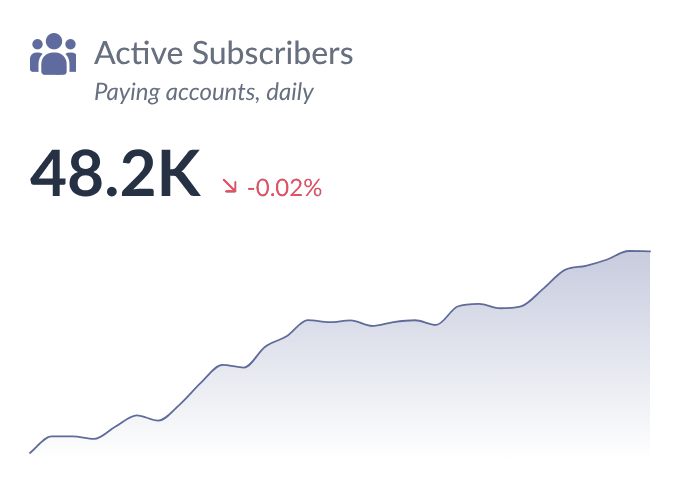
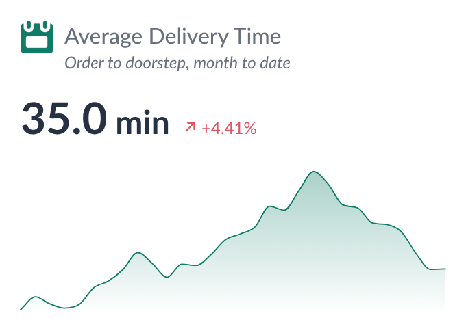

# KPI Card — Tableau Viz Extension

By [ilyas coban](https://www.linkedin.com/in/ilyascoban/).

<p>
  
  
</p>

A Tableau viz extension built from the Figma component **KPI Card 3**
(file *Tableau-Dashboards*, node `9:2939`): an icon, a title, optional explanation text, a big number with a unit,
a % / pp change, and a 30-day trend line or "vs previous period" text.

```
kpiCard.trex    manifest: Marks card tiles + "Format Extension" button
index.html       card page
card.css/js      card layout, data reading, rendering
configure.*      Format dialog (every option below)
config.js        shared defaults (taken from Figma), formatting helpers
icons.js         the built-in icon list (loaded before config.js)
icons/extension/ the Figma icons as 96 px transparent PNGs
../serve.sh    local server (repo root) on :8766, also lists Tableau shape palettes
../shared/ API library, Lato fonts and timing.js, shared by every extension in the repo
```

## Run it

```bash
cd .. && chmod +x serve.sh && ./serve.sh     # from the tableau_extensions repo root
```

Preview without Tableau: `http://localhost:8766/kpi-card/dev/preview.html` (`?debug` for load timings). Pick a data set (negative, flat, gaps, no date, Tooltip tile, renamed pill, 2,500 rows) and a card size from the toolbar; the data is about 26 months of made-up daily retail sales.

Then in Tableau Desktop (2024.2+): on the Marks card, open the mark type dropdown, choose **Add Extension**, then
**Access Local Extensions**, and pick `kpiCard.trex`.

| Marks card tile | What to drop | Drives |
| --- | --- | --- |
| **Measure** | the metric | everything: big number, change, trend line |
| **Date** | any date level — YEAR, QUARTER, MONTH, WEEK, DAY, exact date — or up to 4 combined (e.g. YEAR + MONTH) | ordering by date |

- **Big number** = the measure's value at the latest date, or month to date (Big number tab → Value; independent of the % Change period).
- **% / pp change** = latest date vs the date before it, or vs the same day last month — as single days or month to date.
- **Trend line** = only the last *N* days / weeks / months (30 by default) at the Date field's level, counted on the calendar, so gaps never pull in older dates. Hover a point for its date, the full (unabbreviated) value, and its change.

The Figma defaults are applied automatically. Enter the title and explanation text in the Format dialog. If you leave
the title empty, the card uses the Measure field name.

## The "context menu" → Format Extension

Viz extensions don't get a right-click menu of their own. Tableau shows the manifest's `<context-menu>` as a
**Format Extension** button at the bottom of the Marks card instead. It opens a modeless dialog with six tabs, and every
change shows on the card right away. **Cancel** undoes everything since the dialog opened. **Reset tab** restores the
Figma defaults for that tab.

**Undo and search.** The **↶ / ↷** buttons in the footer (or Ctrl/Cmd+Z and Ctrl/Cmd+Shift+Z) step back and forward through your changes in this dialog; a slider drag or a typed number counts as one step. The search box above the tabs finds a setting on any tab: type two or more letters, click a result, and the dialog opens that tab and highlights the setting.

| Tab | Options |
| --- | --- |
| Icon | show/hide · **14 built-in icons** from the Figma page *Icons for Extension* (chart icons, others) · **Tableau shapes** (palette picker) · upload PNG/SVG/JPG/GIF · **size** 12–96 px on the longer side (default 24, as in Figma). Larger icons sit beside both the title and the explanation. |
| Title & text | title show/hide, text, **alignment** (left / center / right), font, size, weight, colour, italic · explanation on/off, **keep space when empty** (on by default, so big numbers line up across cards), text and the same formatting |
| Big number | show/hide · value: **single day** or **month to date** (sum or average of days) · K / M / B / Dynamic / full / **Percentage** / **Percentage dynamic (K/M/B %)** / workbook format · *Metric is a 0–1 ratio* for the percentage formats · decimals · unit text, position, size (default 24 px) · font, size, weight, colour · shrink-to-fit |
| % Change | compare with **previous date** or **same day last month** · **single day** or **month to date** (sum or average of days) · on/off · % or pp · decimals · positive/negative/no-change colours · "Increase is good" (untick to swap the colours) · font |
| Bottom | Trend line / Change text / Nothing · smooth (default) or straight line · chart colour, gradient strength, line width, points shown, tooltip on/off, height · period word, decimals, sign |
| Card | padding · dashed right divider (as in Figma) · background colour and opacity (transparent by default) |

Settings are saved in the workbook, and that includes uploaded and picked icons (stored as small data URLs). They go
with the workbook when you publish it.

### Built-in icons

The built-in icons come from the Figma page *Icons for Extension* (node `87:231`). They live in `icons/extension/` as 96 px transparent PNGs (4× their 24 px display size), listed in `icons.js`. An icon id that no longer exists falls back to the default (Bar chart).
The workbook only stores the icon's id, so the `icons/` folder must be deployed with the extension.

- All of them are single-colour and follow **Icon color** (default `#EB644C`, i.e. the Figma colour).
- **To add an icon:** export it from Figma as a PNG, drop it in `icons/extension/`, and add a line to `icons.js` with its `id`, `label`, `group`, size, and `tint: true` if it should follow Icon color.

### Tableau shapes

`serve.py` looks for shape palettes in:

- `~/Documents/My Tableau Repository/Shapes/*` (your custom palettes)
- the newest Tableau Desktop install (the built-in *Default, Filled, Arrows, KPI…* palettes)
- any extra folders listed in `KPI_SHAPES_DIRS` (separated by `:` on macOS, `;` on Windows)

```bash
KPI_SHAPES_DIRS="$HOME/Shapes:/Volumes/share/Shapes" ../serve.sh
```

When it starts, the server prints the palettes it found. When you pick a shape, it's copied into the workbook. If the
extension is hosted somewhere without `serve.py`, the Tableau shapes tab shows a note. Upload still works there, and you
can upload any `.png` file from a Shapes folder.

## Click selects in Tableau
Optional (Format → Card → Interaction → **Click selects in Tableau**, off by default). Click the card to select its latest date in Tableau, or click a point on the trend line to select that date, so dashboard filter, highlight and go-to-sheet actions fire. Click the same place again (or press Esc) to clear. It needs a field on the Date tile; without one a click does nothing. While on, the card shows a pointer cursor and a thin outline in the trend line colour once a date is selected.

## Save as picture
Optional (Format → Card → Export → **Save as picture button**, off by default). Shows a button in the top-right corner of the card (on hover) that saves it as a PNG picture. With a transparent card background the picture gets a white background.

## Tableau's own tooltip
Optional (Format → Card → Interaction → **Use Tableau's tooltip**, off by default). Shows the tooltip you design in Tableau (Worksheet → Tooltip), including viz in tooltip, instead of the card's own tooltip. Hovering the trend line shows the tooltip of the hovered date; hovering anywhere else on the card shows the tooltip of the latest date. Needs Tableau 2024.2 or newer; on older versions the card's own tooltip is used.

## Brand theme
Presets tab → **Brand theme**: apply a theme file (or one of the bundled themes) to this card, or save this card's look as a theme to reuse in the other extensions.

## Tooltip tile → tooltip

Measures dropped on Tableau's own **Tooltip** tile (Marks card) are listed in the tooltip, in tile order:
hovering the trend line shows their values at that date; hovering anywhere else on the card shows the
latest date (turn that off with *Tooltip on the card*). Rows that share a date are added up, like the main measure.
Dimensions on the Detail / Tooltip tiles only add rows; they are never read as dates.

Format Extension → **Tooltip**:
- **Measure names / Measure values / Heading**: font, size, weight, italic (heading also color), shared by all tooltip measures;
- per measure (pick it from the list): **Name** (empty = the field name) and whether it's shown;
  **Value format** (dynamic K/M/B, fixed K/M/B, full number, percentage with the 0–1 ratio option, workbook format; decimals, unit and position);
  **Name color** and **Value color**, each by *Single* color, *+ / −* (positive / negative / zero by the value's sign) or *Conditional* rules
  (`>`, `≥`, `<`, `≤`, `=`, `≠`, `between`; first match wins, else *Otherwise*). Rules compare the raw value (a ratio stays 0.45, not 45%).

Settings are stored per measure name without aggregation (`details.items`), so SUM → AVG keeps them.

## Number and change logic

- **Big number**: `1336040000` with format *M* and 2 decimals shows as `1,336.04M`. *Dynamic* picks K, M or B from the size of the number.
- **Percentage formats**: the % sign is part of the number, at the same size. With *Metric is a 0–1 ratio* ticked, 0.4523 shows as `45.23%`; unticked, 45.23 shows as `45.23%`. *Percentage dynamic* also abbreviates large values, so 1,336.04 (a ratio) shows as `133.60K%`. Differences between two percentages (in the tooltip and the change text) are shown in percentage points, e.g. `-11.36 pp`.
- **% change**: `(latest − previous) / |previous|`. It's hidden when previous is 0 or there's nothing to compare with.
- **Comparison base** (% Change tab):
  - *Previous date* + *Single day*: the value at the date before the latest.
  - *Same day last month* + *Single day*: 11 Oct vs 11 Sep. Days that don't exist clamp to the month end (31 Mar vs 28/29 Feb). No value on that day → no change shown.
  - *Month to date*: 1–11 Oct vs 1–11 Sep (same day last month), or vs MTD as of the previous date. Days are summed (flows) or averaged (balances, ratios).
  - Same day last month and MTD need real dates on the Date tile (exact date, or DAY/MONTH as a date), not date parts. They read the full data, so they work even when *Points shown* hides last month from the trend line.
- **pp change**: `latest − previous`. With *Metric is a 0–1 ratio* ticked, the difference is multiplied by 100, so 0.45 vs 0.40 gives `+5.00 pp`.
- **Arrows**: ↗ when the change is positive, ↘ when negative, → when zero. The colour follows *Increase is good*.
- **Change text**: `-1,135.8M less than previous period`. It uses the big number's scale and colour, the explanation text's size, and is never italic.

### How dates are ordered

The card sorts by the Date field itself, not by Tableau's row order, so any level works:

- real dates (exact date, or truncated like *May 2026*) sort by time
- date parts sort by number or name: `2026`, `Q2`, `Week 18`, `May`, `Monday`
- several date fields sort coarse to fine (YEAR, then QUARTER, then MONTH ...), whatever order you dropped them in

A date *part* on its own drops the year, so MONTH alone would merge May 2025 and May 2026 into one "May". For data that
covers more than a year, add YEAR alongside it, or use the truncated form (right-click the pill → the second MONTH, which
shows *May 2026*).

## Transparent background

The card background is transparent by default. To see the dashboard behind it:

- set **Format → Shading → Worksheet** to *None*
- set the dashboard object's and container's background to *None*

## Presets

The last tab of the Format window saves and loads every setting of the card. **Export** a preset as "Look only" (leaves out title and explanation text, per-measure tooltip items, row limit) or "Everything"; download it as .json, copy it, or keep it under **My presets** on this computer. **Import** from a file or pasted text; "Keep this card's…" keeps the sheet-specific settings. Presets store only values that differ from the defaults, and carry a version so older files keep working.

Sample files to import: `presets/Default.json` (the default look) and `presets/Dark.json` (dark card, light text) (in the `presets/` folder; the Format window doesn't list them, use Import → Choose file).

## Deploying

1. The Tableau Extensions API library is bundled in `../shared/lib/tableau.extensions.1.17.0.min.js` (shared by all extensions, no CDN). To upgrade, replace that file and update the `<script>` path in `index.html` and `configure.html`.
2. Host the folder over HTTPS and change `<source-location><url>` in `kpiCard.trex`.
3. Add the URL to the Tableau Server/Cloud extension safe list.

If you edit the `.trex`, remove the extension and add it again, because Tableau reads the manifest only when the extension is added.

### Performance with many cards

Measured on Tableau Server (Stock overview dashboard, 11 cards): Tableau answers **every extension call from every card through one queue**, one call at a time, about 90 ms each. First all handshakes (`initialize-add-in-instance`), then the data calls. So the number of calls per card decides how long the last card waits.

- **2 calls per card**: the handshake and one `getSummaryDataAsync` (`get-summary-data`). The summary-data reader needed 3 (create reader, get page, release).
- **Marks card read once per browser.** `getVisualSpecificationAsync` is only called when this browser hasn't seen the sheet's column set before; the fields per column set are kept in localStorage (`kpi-card:fields:v1`, newest 60). New fields on the Marks card change the columns, so they're read again.
- **One data request at a time.** When filters change, the card waits 150 ms for the changes to settle, keeps at most one data read going, and does one catch-up read at the end.
- **Hidden cards wait.** A card in a hidden (zero-size) zone doesn't ask for data until it's shown.
- **API library starts downloading first** (`<link rel="preload">`).
- **No saved results.** The card always draws live data.

Build each card's sheet at the date level, without extra fields on Detail, so Tableau sends one row per date.

### Slow or failed loads

- A slow handshake is normal on a busy dashboard (the card is waiting in Tableau's queue), so the card **never reloads because of a timeout**: that would only send it to the back of the queue and slow every other card. It shows *Loading…* after 2.5 s and keeps waiting; after 90 s it adds *Click to reload this card* (it still draws if Tableau answers later).
- The frame reloads itself (max 3 times, count in `#kpiRetry=n`) only when a file (API library, card.js) didn't arrive or Tableau **rejected** the handshake.
- A data call Tableau rejects is tried again twice after a short pause.

### Load timings (debug)

To see where load time goes, open the dashboard, open DevTools, pick this extension's frame in the Console's context dropdown, run `localStorage.setItem('extDebug', '1')` and reload. Each load then prints a table of steps (page received, API library loaded, Tableau handshake, fields received, data received with row count, result drawn) plus every file with its download time and whether it came from the browser cache. Later refreshes (filters etc.) print one line each. `extTimings()` prints the table on demand; `localStorage.removeItem('extDebug')` turns it off. In the dev preview, add `?debug` to the URL instead.

## Data limit, errors and privacy

- **Maximum rows.** The extension reads at most 1,000 rows from the worksheet by default. Change it in *Format → Card → Maximum rows* (0 = all rows). When rows are left out, a note in the bottom-left corner says "Showing the first N rows".
- **Errors.** If something goes wrong, a small **!** mark appears in the bottom-right corner. Click it for details you can copy (extension version, Extensions API version, the error) and a Reload button.
- **Nothing is kept in the browser.** The chart is always drawn from live worksheet data; no data is stored between visits.
- **What changed in each version:** [CHANGELOG.md](CHANGELOG.md).
