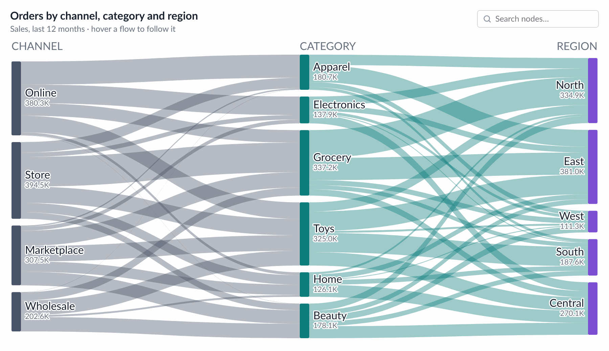
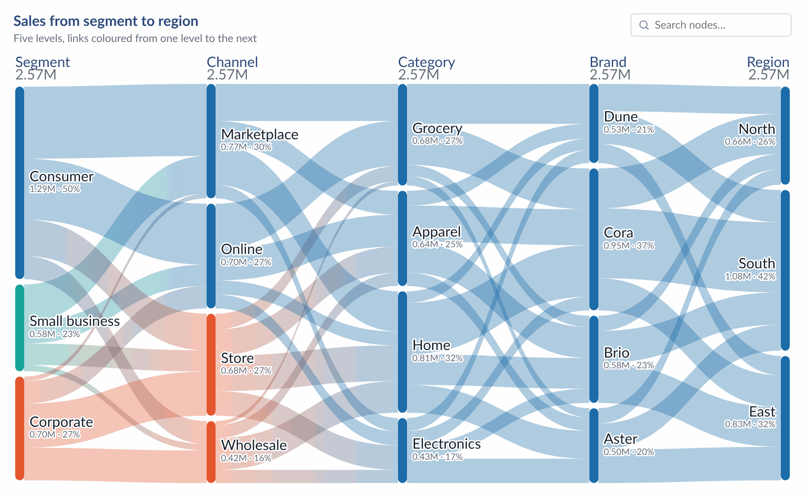

# Sankey — Tableau Viz Extension

A flow diagram where **link thickness is a measure**. Each dimension on **Levels** is a column of nodes (one node per
member, left to right); a link joins members of neighbouring columns and is as thick as the summed **Value** of the
rows that pass through both. Hover a node and everything flowing through it lights up; click a node or a link to select
it in Tableau for dashboard actions. The icon, title and explanation are the same as **KPI Card**; the card options and
presets are the same as **Bar Chart**.

<p>
  
</p>
<p>
  
</p>

```
sankey.trex        manifest: Marks card tiles + "Format Extension" button
index.html         chart page
chart.css/js       header, legend, search, data reading, graph, layout, SVG drawing, highlight, tooltip, right-click menu
configure.*        Format dialog (every option below)
config.js          shared defaults, settings read / write, number format, colours
icons.js, icons/   the Figma icons from *Icons for Extension* (same files as KPI Card)
../shared/         API library, Lato fonts and timing.js, shared by every extension in the repo
presets/           sample presets (Default, Colorful gradient)
dev/               browser preview with sample data (no Tableau needed)
```

## Run it

```bash
cd .. && chmod +x serve.sh && ./serve.sh     # from the tableau_extensions repo root
```

In Tableau Desktop (2024.2+): Marks card → mark type dropdown → **Add Extension** → **Access Local Extensions** →
`sankey.trex` (in the `tableau-extensions` folder; it loads the extension from GitHub Pages).

To try it without Tableau, open <http://localhost:8766/sankey/dev/preview.html>. It has six sample data sets (Channel ›
Category › Region, a two-level Source › Target, five levels, a 1,500-row stress test, empty / zero / negative values,
renamed pills) and opens the Format dialog next to the chart.

| Marks card tile | What to drop | Drives |
| --- | --- | --- |
| **Levels** | 2–6 discrete dimensions, **one at a time**, outermost (left) first | one column per field, in tile order |
| **Value** | one continuous measure (required) | link thickness and node height |
| **Tooltip** (Tableau's) | measures (optional) | extra tooltip rows, summed over the rows behind the node or link |

- Nodes are matched **by name within a column**. Two members with the same name become one node.
- A node is as tall as the Value flowing through it (the larger of inflow and outflow).
- **Empty values**: by default a row with an empty level skips that column and its link jumps over it. *Levels & data →
  Rows with an empty level* can show a “Null” node instead.
- Rows whose Value is empty, zero or negative are not drawn; a note in the corner says how many.

## In the chart

- **Hover** a node: everything flowing through it lights up, the rest dims. Hover a link: the link and its two nodes.
  The tooltip shows the value and shares: a node's share of its column, a link's share of the source's outflow and of
  the target's inflow.
- **Click** a node: selects that member in Tableau and keeps the highlight. Click a link: selects both members. Click
  it again, empty space, or press Esc to clear.
- **Search** (top right): finds nodes by name in any column and outlines them, highlighting their flow (or showing only it).
- **Labels** sit beside the nodes (right, left in the last column; or forced to one side) with the name, the formatted
  value and optionally the share of the column total. Long names get an ellipsis; labels that would overlap are left out.
- **Top N per level**: keep the N largest members of each level and merge the rest into one “Others” node (off by default).
- **Double-click** a node: opens Format → Levels & data on its level. **Right-click**: select, search, format, quick links.
- **Save as picture** (Format → Card → Export): a button in the top-right corner, shown on hover, saves a PNG.
- **Tableau's tooltip** (off by default; Search & actions → Tooltip): shows the tooltip you design in Tableau instead of
  this extension's own. A node or link stands for many rows; Tableau's tooltip uses the first of them. Needs Tableau
  2024.2 or newer.

## Format dialog

**Format Extension** at the bottom of the Marks card, or right-click the chart. The chart updates as you change things.
**Cancel** undoes everything since the dialog opened; **Reset tab** restores that tab's defaults.

| Tab | Options |
| --- | --- |
| Icon | as KPI Card: built-in icons or **upload** (off by default) |
| Title & text | show, text, alignment, font, size, weight, colour; explanation. `{total}`, `{nodes}`, `{links}`, `{flow}` and `<Parameter>` work in texts |
| Levels & data | per level: column header, legend name, node colour · order in columns (flow, value, name) · top N + “Others” · empty levels (skip or “Null” node) |
| Nodes & labels | node width, corner radius, vertical gap · colour by level, first-level member or one colour · labels: side, value, % of column, width, outline, font |
| Links & highlight | link colour (source, target, gradient, one colour) and opacity · hover highlight, highlighted and dimmed opacity, search outline |
| Numbers | scale (dynamic K / M / B, fixed, full, percentage), decimals, unit and position |
| Headers & legend | column headers (font, uppercase, spacing, column totals) · legend of level colours |
| Search & actions | search box · tooltip parts · Tableau's tooltip · select in Tableau · right-click menu · double-click · Format window on top or floating |
| Card | padding, space above the chart, backgrounds · save as picture · maximum rows |
| Presets | export, import and save settings · apply or save a brand theme (colours, fonts) shared by all extensions |

## Settings and deploying

Everything is stored in the workbook under one settings key (`sankey1`). Level colours are stored by position; column
headers and legend names by field name, so renaming a pill starts those from the defaults. Renamed pills are still
matched to their data columns by position.

1. The Tableau Extensions API library is bundled in `../shared/lib/tableau.extensions.1.17.0.min.js` (shared by all extensions, no CDN).
2. Run `python3 release.py` (repo root) before every commit: all checks plus cache-busting for GitHub Pages.
3. Host the folder over HTTPS (GitHub Pages: `Cobani/tableau_extensions`, folder `sankey/`) and check `<source-location><url>` in
   `sankey.trex`.
4. Add the URL to the Tableau Server extension safe list. `dev/` doesn't need to be deployed.

Tableau reads the `.trex` only when the extension is added, so after editing it, remove the extension and add it again.

### Presets

Presets (Format → Presets) store only the settings that differ from the defaults, with a format `version` (now 1).
When the extension changes:

- a new option needs nothing: presets without it get its default;
- a setting tied to the sheet's fields goes into `FIELD_PATHS` (left out of *Look only* presets);
- a renamed or moved setting bumps `PRESET_VERSION` and gets a step in `PRESET_MIGRATIONS` (`configure.js`), and the
  files in `presets/` are re-saved in the new version.

### Performance

- Hover and click only change opacity on the existing shapes; the layout runs only when data, size or settings change.
- With many nodes the vertical gap shrinks and labels that would overlap are left out (smallest nodes first).

### Load timings (debug)

In DevTools, pick this extension's frame in the Console, run `localStorage.setItem('extDebug', '1')` and reload. Each
load prints a table of steps and files. `extTimings()` prints it on demand; `localStorage.removeItem('extDebug')`
turns it off. In the dev preview, add `?debug` to the URL.

## Data limit, errors and privacy

- **Maximum rows.** The extension reads at most 1,000 rows from the worksheet by default. Change it in *Format → Card → Maximum rows* (0 = all rows). When rows are left out, a note in the bottom-left corner says "Showing the first N rows".
- **Errors.** If something goes wrong, a small **!** mark appears in the bottom-right corner. Click it for details you can copy (extension version, Extensions API version, the error) and a Reload button.
- **Nothing is kept in the browser.** The chart is always drawn from live worksheet data; no data is stored between visits.
- **What changed in each version:** [CHANGELOG.md](CHANGELOG.md).
