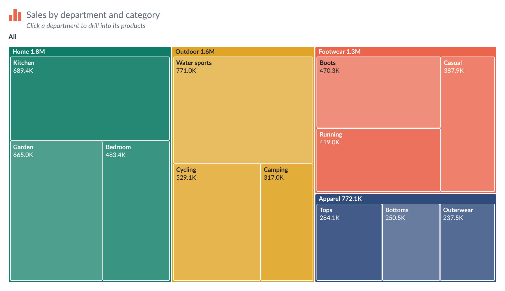
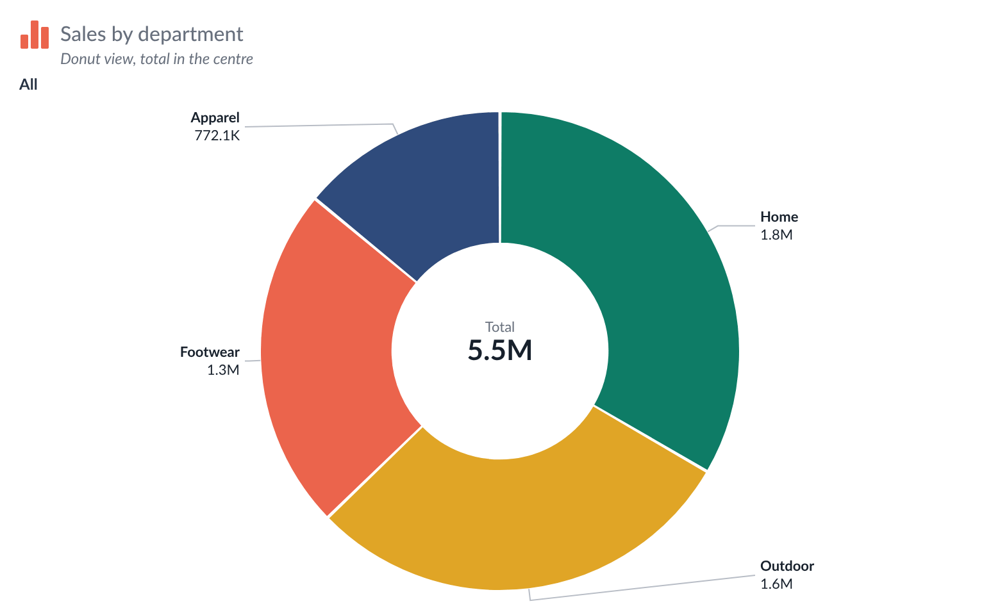

# Treemap & Donut — Tableau Viz Extension

The composition of a whole, with drill-down through a hierarchy (department › category › product). A treemap, a donut or a pie;
click a tile or slice to look inside it, and a path above the chart ("All › Apparel › Shoes") to go back.
Part of the `tableau_extensions` repo (shared files in `../shared/`).

<p>
  
</p>
<p>
  
</p>

## Run it

```bash
cd .. && chmod +x serve.sh && ./serve.sh     # from the tableau_extensions repo root
```

In Tableau Desktop (2024.2+): Marks card → mark type dropdown → **Add Extension** → **Access Local Extensions** → `treemap-donut.trex`.

To try it without Tableau, open <http://localhost:8766/treemap-donut/dev/preview.html>. It has six sample data sets (three levels with
about 120 leaves, one flat level, one member holding 80 %, odd data with zeros / negatives / nulls / duplicate names, 1,500 leaves,
renamed pills) and opens the Format dialog next to the chart.

## Marks card tiles

| Marks card tile | What to drop | Drives |
| --- | --- | --- |
| **Category** | 1 to 4 dimensions, outermost first | the hierarchy: each dimension is one level to click into (required) |
| **Size** | one measure | the area of a tile / angle of a slice (required) |
| **Colour** | one measure (optional) | shades the tiles, e.g. growth %; use *Format → Colours → Colour measure* |
| **Tooltip** (Tableau's own) | any fields | accepted; with *Use Tableau's tooltip* the hover shows Tableau's tooltip for the first row under the item |

- Items with a zero, negative or missing size are left out; a note under the chart says "N items with zero or negative size are not shown".
- The same name under different parents (two "Accessories") stays two separate items.

## What it draws

- **Treemap**: squarified tiles. With *Levels shown at once* = Two, each first-level group gets a header and contains its second-level tiles.
- **Donut**: a ring with centre text (the total, or the hovered slice's name, value and share). Slices below a share threshold are grouped into "Others".
- **Pie**: a donut with no hole.
- **Drill**: click an item with children to open it. *Format → Chart → Click*: *Opens the tile* (default; items without children are selected),
  *Selects it in Tableau*, or *Click selects, double-click opens*. In a donut, click the hole to go up one level.
- **Selecting** sends every level's value down to the clicked item, so dashboard actions can filter by it. Click it again, or press Esc, to clear.
- **Labels**: name, value, share of the parent and share of the total, each switchable. Treemap labels are clipped to the tile and left out when
  they do not fit; donut labels sit outside the ring on two columns with leader lines and never overlap (or use the legend only).
- **Colours**: by first-level member (palette, own colour per member), tints of the parent colour for the items inside, or by the Colour measure
  (ramp, optional centre value, small legend bar).
- **Tooltip**: path, value, share of the parent and of the total, the Colour measure, how many items are inside.
- **Save as picture** button (top-right corner, on hover).

## Format dialog

Icon · Title & text · **Chart** (type, levels, order, grouping into Others, path, click behaviour, tooltip) · **Layout** (gaps, padding, corner radius,
ring thickness, border) · **Labels** · **Colours** · **Centre & legend** · **Numbers** (size format, Colour measure format, font) · Card · Presets.
Right-click the chart for a shortcut menu. The window stays on top of Tableau and the chart updates live.

## Presets

The last tab saves and loads every setting. **Export** "Look only" leaves out member colours, the title / explanation text, the path's top name and the row limit,
which belong to your data. It also has **Brand theme** (shared by all extensions). Samples: `presets/Default.json` and `presets/Dark.json`.

## Settings and deploying

Everything is saved in the workbook under one settings key (`treemapDonut1`). Own colours are stored by the first-level member's name.

1. The Tableau Extensions API library is bundled in `../shared/lib/` (no CDN).
2. Host the repo over HTTPS and change `<source-location><url>` in `treemap-donut.trex`.
3. Add the URL to the Tableau Server/Cloud extension safe list. `dev/` doesn't need to be deployed.

Tableau reads the `.trex` only when the extension is added, so after editing it, remove the extension and add it again.

### Load timings (debug)

Open DevTools, pick this extension's frame, run `localStorage.setItem('extDebug', '1')` and reload to see where load time goes.

## Data limit, errors and privacy

- **Maximum rows.** The extension reads at most 1,000 rows from the worksheet by default. Change it in *Format → Card → Maximum rows* (0 = all rows). When rows are left out, a note in the bottom-left corner says "Showing the first N rows".
- **Errors.** If something goes wrong, a small **!** mark appears in the bottom-right corner. Click it for details you can copy (extension version, Extensions API version, the error) and a Reload button.
- **Nothing is kept in the browser.** The chart is always drawn from live worksheet data; no data is stored between visits.
- **What changed in each version:** [CHANGELOG.md](CHANGELOG.md).
