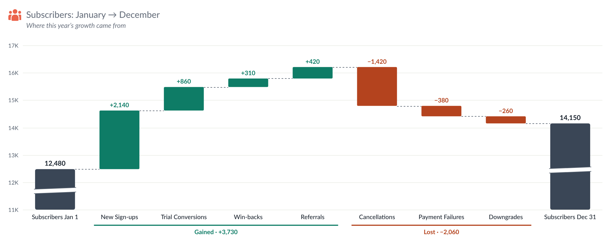
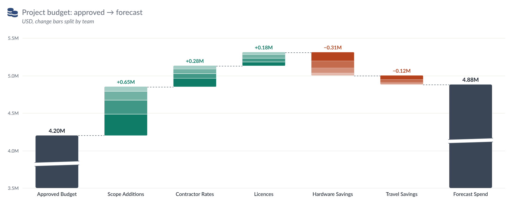

# Waterfall — Tableau Viz Extension

A waterfall chart (Start → changes → End) based on the *Stock flow* Figma mockup. The icon,
title, explanation and card options are the same as **KPI Card 3**, and so is the number formatting.

<p>
  
</p>
<p>
  
</p>

```
waterfall.trex   manifest: Marks card tiles + "Format Extension" button
index.html       chart page
chart.css/js     header, data reading, chart drawing, tooltip, right-click menu
configure.*      Format dialog (every option below)
config.js        shared defaults, number formatting
icons.js, icons/extension/ the 14 Figma icons from *Icons for Extension* (same files as KPI Card)
../shared/ API library, Lato fonts and timing.js, shared by every extension in the repo
../serve.sh    local server (repo root) on :8766, also lists Tableau shape palettes
dev/             browser preview with sample data (no Tableau needed)
```

## Run it

```bash
cd .. && chmod +x serve.sh && ./serve.sh     # from the tableau_extensions repo root
```

In Tableau Desktop (2024.2+): Marks card → mark type dropdown → **Add Extension** → **Access Local Extensions** →
`waterfall.trex`.

To try it without Tableau, open <http://localhost:8766/waterfall/dev/preview.html>. It has four sample data sets (the Figma
stock flow, a breakdown dimension, raw values, negative values; the breakdown set has two dimensions) and opens the Format dialog next to the chart.

| Marks card tile | What to drop | Drives |
| --- | --- | --- |
| **Start** | one measure | the first bar |
| **Changes** | one measure per change, dropped **one at a time** (up to 30) | the bars in between, in the order of the pills on the tile (or sorted, see *Order of the changes*) |
| **End** | one measure | the last bar. Leave it empty to calculate End = Start + changes |
| **Breakdown** | one or more dimensions (optional, up to 6) | splits change bars into segments, e.g. by account type and segment. Each bar picks which of these it uses (Format → Bars → Breakdown) |

- Change bars float from the running total. Start and End bars stand on the axis.
- If End doesn't equal Start + changes, the End tooltip shows the difference.
- **Start and End ignore the Breakdown** (Bars → All bars): by default Start and End are added up over the Breakdown
  members, like the changes. If they come from FIXED / EXCLUDE calculations (or anything else that repeats the same
  total on every row), that multiplies them by the number of members. Tick this option and the chart first asks
  Tableau for only the Start / End columns; if Tableau returns them as one row (aggregated without the Breakdown), that
  exact value is used — the same as with no Breakdown on the Marks card. The console says which way it went
  (*Start/End without the Breakdown: N row(s)*). Otherwise the value is taken once. If the
  members disagree, the most common value is shown and the tooltip says so; make that measure with
  `{ EXCLUDE [Breakdown fields] : SUM([Opening Stock]) }`. Dev preview: *Breakdown, balances repeat per row (LOD)*.
- If outflows are stored as positive amounts, tick **Invert sign** for those bars.
- A change of exactly 0 is written with its bar's sign: **+0.0**, or **−0.0** when *Invert sign* is ticked (it also takes the Decrease colour and joins the decreases group). A change that only rounds to zero keeps its own sign.
- If Tableau delivers the changes as *Measure Names / Measure Values*, the extension pivots them back. Nothing to do.

## Formatting

Viz extensions can't add their own entries to Tableau's right-click menu. There are two ways in:

- **Format Extension** button at the bottom of the Marks card (the manifest's `<context-menu>`).
- **Click a breakdown segment** (Format → Bars → All bars → *Click selects in Tableau*, off by default) to select that
  member in Tableau, so dashboard filter and highlight actions fire. Click it again, click an empty area or press
  Escape to clear. Bars without a Breakdown have nothing to select.
- **Right-click a bar** in the chart → *Format "Online Sales"…*, Groups…, Axes…, Lines…, Numbers…. **Double-click** a bar
  opens its settings directly.

The dialog is modeless, so the chart updates as you change things. **Cancel** undoes everything since the dialog
opened, and **Reset tab** restores the defaults for that tab.

| Tab | Options |
| --- | --- |
| Icon | as KPI Card 3: built-in Figma icons, Tableau shapes, upload, size, colour |
| Title & text | as KPI Card 3. An empty title shows "Start → End" |
| Bars | pick **Start**, any **change**, or **End**, then set it:<br>• label · colour (changes: Increase/Decrease colour or custom) · invert sign<br>• **total value**: show/hide, place (above, inside top/middle/bottom, below, or at the end it moves to), size, weight, colour<br>• **clipped-bar marker** (bar is longer than it looks): show/hide, slanted lines (Figma) / zigzag / gap, position, colours<br>• **breakdown** (changes): show/hide, **which Breakdown dimensions** this bar splits by (tick one or several) and their **order in the segment name** (▲ ▼), name separator, colours (shades of the bar colour, or one colour per member), divider lines, show values, member names, place (inside / left / right), size, weight, text colour, hide on small segments<br>• **segment order** (changes): same as All bars, or its own — the order of the segments and of the tooltip rows<br>• *Apply these settings to all changes*<br>**Order of the changes:** as on the Marks card · value high→low / low→high · size (without sign) largest / smallest first; sort **all changes together** or **within each group** (groups stay in place). Start and End never move.<br>**All bars:** width, corner radius, Increase/Decrease colours, breakdown order (default / value / size / name A→Z, Z→A — also the tooltip order), calculate End, tooltip, right-click menu |
| Groups | none · **increases / decreases** (runs of consecutive ups and downs, like *Incoming · +412.6* in Figma) · **custom** groups you name and assign. Per group: text, colour, show total. Style: line (solid, dashed, dotted, bracket), width, inset, text size and weight, separator, optional shading behind the bars |
| Axes | **Vertical:** starts at zero / close to the data (room below, %) / fixed value · fixed or automatic maximum · tick count · side · title (e.g. *Stock (M)*) · font, size, weight, colour · axis line · own number format or the shared one. **Horizontal:** labels on/off, horizontal (wrapping) / angled / vertical, max lines, font, size, weight, colour, axis line |
| Lines | horizontal gridlines, vertical gridlines, connector lines, zero line: each with show, colour, width, solid / dashed / dotted |
| Numbers | **All numbers the same** or **Each label its own** · K / M / B / Dynamic / full / Percentage / Percentage dynamic / workbook format · 0–1 ratio · decimals · unit text and position · "+" on increases · negatives as −201.4, -201.4 or (201.4) · chart font |
| Card | as KPI Card 3: padding, space above the chart, dashed divider, background colour and opacity |

With **Each label its own**, every bar's total, every breakdown and the group totals get their own format editor. Each
one starts as a copy of the shared format, and *Copy this format to every label* resets them all to it.

### When the axis doesn't start at zero

With *Starts at → Close to the data*, the axis begins a little below the lowest running total (rounded to a tick), as in
the Figma design. Start and End bars are then cut short, so they get the clipped-bar marker. Switch to *Zero* for full
bars.

## Presets

The last tab of the Format window saves and loads every setting of the chart. **Export** a preset as "Look only" (leaves out per-bar settings, breakdown members and colours, custom groups, bar labels, title and explanation text, row limit) or "Everything"; download it as .json, copy it, or keep it under **My presets** on this computer. **Import** from a file or pasted text; "Keep this chart's…" keeps the sheet-specific settings. Presets store only values that differ from the defaults, and carry a version so older files keep working.

Sample files to import: `presets/Default.json` (the default look) and `presets/Dark.json` (dark card, light text) (in the `presets/` folder; the Format window doesn't list them, use Import → Choose file).

## Settings and deploying

Change settings are stored per measure, by the pill's name (e.g. `SUM(Online Sales)`). Everything is saved in the workbook.

**Renaming pills.** Renaming a pill on the Marks card (double-click, type `//New name`, Shift+Enter) keeps its
settings and its breakdown: the chart remembers the pill names it last saw, and a name that disappears while a new one
appears in the same place is treated as a rename. The data column is then found by position when Tableau reports it
under another name (the console logs *matched renamed fields by position*). Replacing a pill with a different field
in the same place counts as a rename too, so it keeps that slot's settings; use *Reset this bar* to start fresh.
The pill names are remembered in the browser (localStorage, per worksheet), not in the workbook, because writing workbook settings makes Tableau reload the extension; the workbook is only saved when settings actually move to a new name. Rename pills on the same machine the chart was last opened on.

1. The Tableau Extensions API library is bundled in `../shared/lib/tableau.extensions.1.17.0.min.js` (shared by all extensions, no CDN). To upgrade, replace that file and update the `<script>` path in `index.html` and `configure.html`.
2. Host the folder over HTTPS and change `<source-location><url>` in `waterfall.trex`.
3. Add the URL to the Tableau Server/Cloud extension safe list. `dev/` doesn't need to be deployed.

Tableau reads the `.trex` only when the extension is added, so after editing it, remove the extension and add it again.

### Load timings (debug)

To see where load time goes, open the dashboard, open DevTools, pick this extension's frame in the Console's context dropdown, run `localStorage.setItem('extDebug', '1')` and reload. Each load then prints a table of steps (page received, API library loaded, Tableau handshake, fields received, data received with row count, cached/live result drawn) plus every file with its download time and whether it came from the browser cache. Later refreshes (filters etc.) print one line each. `extTimings()` prints the table on demand; `localStorage.removeItem('extDebug')` turns it off. In the dev preview, add `?debug` to the URL instead.

## Data limit, errors and privacy

- **Maximum rows.** The extension reads at most 1,000 rows from the worksheet by default. Change it in *Format → Card → Maximum rows* (0 = all rows). When rows are left out, a note in the bottom-left corner says "Showing the first N rows".
- **Errors.** If something goes wrong, a small **!** mark appears in the bottom-right corner. Click it for details you can copy (extension version, Extensions API version, the error) and a Reload button.
- **Nothing is kept in the browser.** The chart is always drawn from live worksheet data; no data is stored between visits.
- **What changed in each version:** [CHANGELOG.md](CHANGELOG.md).
